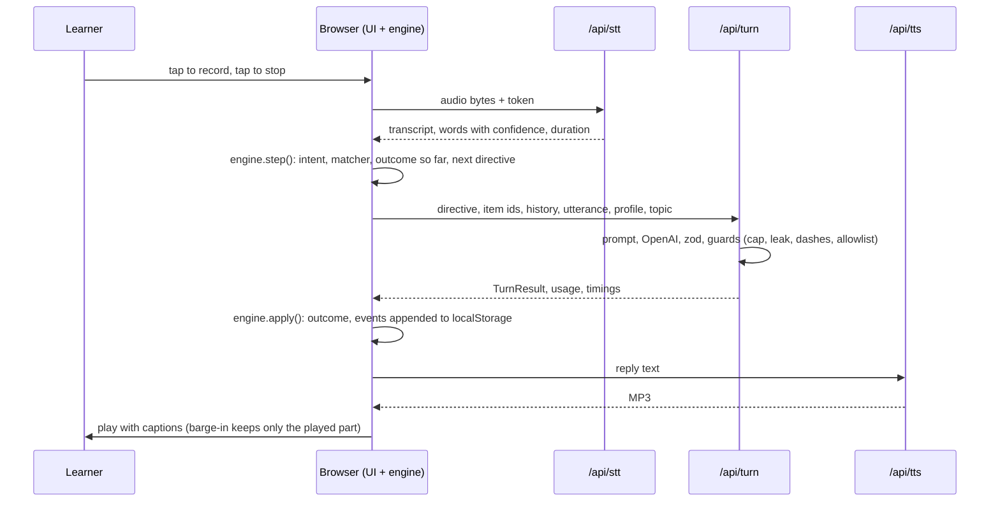

# Vocab Coach: Phase 0 plan (M0)

Status: planning only. No application code has been written. The brief is saved verbatim as `docs/BRIEF.md` and the research as `docs/research.md`.

**Approved 26 Oct 2026:** D1 to D16 and I1 to I26, as written, including Deepgram for STT and TTS. From here on they are fixed; any change goes through `CHANGES.md`. The other §11 answers are still open.

**Change from the brief, at your request (26 Oct):** the LLM is OpenAI (`gpt-6-luna`), not Gemini. Speech stays on Deepgram, because OpenAI's speech APIs can't meet two of the brief's requirements (D16). The Gemini findings are kept in §1 for reference.

How to use this: §1 is what I checked against official docs today. §2 to §4 cover architecture, files and the engine. §5 is milestones, §6 tests, §7 accounts and env vars, §8 voice options, §9 risks. **§10 lists every contradiction and ambiguity with my recommended resolution, numbered so you can approve or amend by number.** §11 is what I need from you before M1.

---

## 1. Verified dependencies (checked 26 October 2026)

| Item | Finding | Effect on the plan |
|---|---|---|
| **Next.js** | 16.4.3 is the latest stable (published 23 Oct 2026). Needs Node ≥ 20.9. `next build` type-checks with the project-local `tsc` CLI. `next lint` is gone; ESLint runs directly with `eslint-config-next`. | Pin `next@16.4.3`, `eslint-config-next@16.4.3`. |
| **TypeScript** | Latest is 7.0.2 (the native compiler, no JS compiler API). `typescript-eslint` 8.72.1, which `eslint-config-next` depends on, supports TypeScript `>=4.8.4 <6.1.0`. | Pin **TypeScript 6.0.3** so the engine lint rule works (D12). |
| **Deepgram STT** | `POST /v1/listen` takes raw audio bytes with a `Content-Type`. `model=nova-3` supports `language=en-IN` for pre-recorded audio, and Deepgram calls Nova-3 its "highest-performing general-purpose ASR". `punctuate` and `smart_format` are booleans. `keyterm` exists (Nova-3 only); we never send it. Per-word `confidence` is at `results.channels[0].alternatives[0].words[]`, duration at `metadata.duration`. WebM and MP4 are supported, max file 2 GB. `mip_opt_out=true` opts a request out of the Model Improvement Program; opted-out data "is retained only for the duration necessary to process the request". The docs say to check pricing impact before opting out. | `?model=nova-3&language=en-IN&punctuate=true&smart_format=true&mip_opt_out=true`. Plain `fetch`, no SDK. |
| **Deepgram Aura-2** | `POST /v1/speak?model=aura-2-<name>-en`, JSON body `{ "text": ... }`. MP3 is the default encoding (`bit_rate` 32000 or 48000, `sample_rate` 22050). `mip_opt_out` is supported. 41 English voices: American, British (draco, pandora), Australian and Filipino; none Indian. A `speed` parameter exists. | MP3 at 48 kbps, `mip_opt_out=true`. Speed stays client-side via `playbackRate`, as the brief says, so Repeat slower costs nothing. |
| **OpenAI model (used)** | `gpt-6-luna`, described as "Our most efficient model for focused, high-volume tasks". Responses and Chat Completions APIs. Reasoning effort `none`, `low`, `medium`, `high`, `xhigh` or `max`; the default is `medium`. Knowledge cutoff 18 May 2026. Build-tier limits: 5,000 RPM, 2M TPM. `gpt-6.1-sol` ($2 / $10) is the next tier up. | `LLM_MODEL=gpt-6-luna`, `LLM_REASONING_EFFORT=none`. `gpt-6.1-sol` is the quality fallback if the judge eval disagrees too often. |
| **OpenAI SDK** | `openai` 7.44.0 (Node ≥ 22; accepts zod `^3.25 \|\| ^4.0`). `client.responses.parse({ model, instructions, input, text: { format: zodTextFormat(schema, "turn") }, reasoning: { effort: "none" }, store: false })` returns `output_parsed`. `usage` has `input_tokens`, `input_tokens_details.cached_tokens`, `input_tokens_details.cache_write_tokens`, `output_tokens` and `output_tokens_details.reasoning_tokens`. The SDK retries 2 times by default. | Set `maxRetries: 0` and `timeout: 6000` on the client, so D6's retry budget holds. |
| **OpenAI structured output** | Strict `json_schema`: the root must be an object, not `anyOf`; every field is in `required`; `additionalProperties: false` everywhere; optional means a union with `null`. Supports `enum`, `anyOf`, number `minimum`/`maximum`, array `minItems`/`maxItems`. `minLength`/`maxLength` are not listed. A response can be a `refusal`, or `incomplete` because of `max_output_tokens`. | `TurnResult` fits as is: `judgement` and `deferred_note` are nullable. The same zod schema drives `zodTextFormat` and enforces string lengths. A refusal or incomplete response counts as a schema failure (I26). |
| **OpenAI caching** | Automatic. From GPT-5.6 on, the minimum cacheable prompt is 1,024 tokens. Cache writes cost 1.25× the uncached input rate and reads are reported in `cached_tokens`. | Put static blocks first (system prompt, allowlist, profile). Don't tune further (I23). |
| **OpenAI pricing** | `gpt-6-luna`: $0.10 input, $0.01 cached, $0.50 output per 1M tokens; cache writes $0.125. | About $0.003 for a 6-minute session's LLM calls. STT and TTS dominate cost. |
| **OpenAI data use** | API data is "not used to train or improve OpenAI models" unless you opt in. Abuse-monitoring logs are "retained for up to 30 days". Responses API application state is kept 30 days by default or when `store` is `true`. Zero Data Retention needs OpenAI's approval. | Every call sends `store: false`. README and About say learner text goes to OpenAI, which may keep it up to 30 days for abuse monitoring. The start-screen line "Audio isn't stored" stays true, because audio only goes to Deepgram. |
| **OpenAI speech (checked, not used)** | STT: `gpt-transcribe` returns `text` and `languages` only, with no per-word confidence, logprobs or word timestamps. Word timestamps exist only on the deprecated `whisper-1` (shuts down 26 Feb 2027). Language codes are ISO 639-1/3, with no `en-IN`. TTS: `gpt-4o-mini-tts`, `tts-1` and `tts-1-hd` are all deprecated and shut down **6 Jan 2027**. The suggested replacement is Realtime-only. | Keep Deepgram for STT and TTS (D16). |
| **Gemini (replaced, for reference)** | `gemini-3.8-flash` exists and is Stable. Its lowest thinking level is `low` (`minimal` errors). Implicit caching needs 4,096 tokens. Paid tier: $0.75 / $3.75 per 1M through 31 Dec 2026, then $1.50 / $7.50; free-tier content is used to improve Google's products. | Not used. The research's §7 and §10 cost model assumes this model; the README will show both. |
| **Deepgram pricing** | Nova-3 pre-recorded $0.0043/min (not marked promotional); Aura-2 $0.030 per 1,000 characters; per-second billing. The page doesn't say whether `mip_opt_out` changes the rate. | Matches research §9. You confirm the opt-out rate in your Deepgram console (§11). |
| **ts-fsrs** | 5.4.2. `default_w` has 21 weights, so FSRS-6 is the default. `fsrs(generatorParameters({ request_retention: 0.9, enable_fuzz: false, enable_short_term: false }))`, `f.next(card, now, rating)`, `f.get_retrievability(card, now, false)` returns a number. **I ran it:** with short-term off, a new card rated Again, Hard, Good or Easy is next due in 1, 2, 3 or 8 days. | FSRS-6, so no FSRS-5 note in the README. Demo consequence: "+1 day" surfaces only Again items; "+3 days" surfaces Good items too. |
| **Vercel** | Request and response bodies max 4.5 MB (413 otherwise). With Fluid compute, Hobby max duration is 300 s. Functions run in one region, default `iad1`, changeable on Hobby. | The 2 MB audio cap fits; send raw bytes, not base64. Each route sets `maxDuration = 30` as a cost guard. Region decided by measurement in M5 (§11). |
| **Others** | zod 4.6.7, react 19.3.1, tailwindcss 4.3.3, eslint 9.39.5 (10.13.0 is latest, but Next's lint plugins don't support it yet), vitest 5.0.5 (needs Node ^22.12 or ^24), openai 7.44.0 (needs Node ≥ 22). | Node 24 locally (24.15 installed) and on Vercel. |

Sources are listed at the end.

---

## 2. Architecture

The brief's flowchart stands. One turn, in order:



Design choices inside the fixed decisions:

- **The learner model is a pure function of the event log.** localStorage holds the log; levels, FSRS cards, mastery and the due list come from `replay(events)`, which runs on load and after each event. Replaying 40 items and a few hundred events takes well under a millisecond. "Replay from empty rebuilds an identical model" is then true by construction, and a test still checks it: incremental build, from-empty build, and a shuffled log with duplicates must all match.
- **Events are facts; rules are code.** An attempt event records what happened (mode, hints used, repaired, revealed, fragment, judge verdict, ASR confidence). The level and FSRS rating are derived in replay from the §5 table, so the rules live in one place.
- **Finalise:** FSRS updates apply only to closed sessions. `finalise(sid)` appends `session_end`, idempotently. On load, any session without one is closed with its last event's time.
- **Every event stores `t` and `day`.** `t` comes from `clock.now()` (including the demo offset); `day` is the local calendar date when it was written. Replay never depends on the browser's current time zone.
- **No clock in the engine.** Every function takes `now`. Lint bans `Date.now()` and argument-less `new Date()` in `src/engine/`, plus `Math.random()` and `performance.now()` (I19).
- **Thin, stateless routes:** zod in, one provider call, zod out. The guards (word cap, target leak, dashes, allowlist notes) are pure functions in `src/engine/guards.ts` that the server calls, so they are tested with the engine.
- **Six runtime dependencies:** `next`, `react`, `react-dom`, `openai`, `ts-fsrs`, `zod`. Deepgram and Upstash are called with `fetch`.

**Routes** (all `POST`; every route except `/api/session` needs `Authorization: Bearer <token>`):

| Route | In | Out | Guards |
|---|---|---|---|
| `/api/session` | `{}` | `{ token, expiresAt, voiceEnabled }` | Same-origin check; per-IP limit if Upstash vars exist |
| `/api/stt` | raw audio, `Content-Type: audio/webm` or `audio/mp4` | `{ transcript, words: [{ w, conf, start, end }], durationS, ms }` | 2 MB, 45 s; one retry; 503 when voice is off |
| `/api/turn` | `{ directive, candidateIds, history (≤ 8), utterance, profile, topic, summary? }` | `{ result: TurnResult, guards: string[], usage, ms }` | Strings capped; ids must exist in the lexicon; at most 2 OpenAI calls (D6); 6 s timeout each; `store: false`; templated fallback |
| `/api/tts` | `{ text }` | `audio/mpeg` | 600 characters; 503 when voice is off |

Token: `base64url({ sid, iat, exp }).base64url(HMAC-SHA256)` using Node `crypto`, with a 12-minute expiry (I12). Server logs hold route, status, latency and error code only.

**Templated fallbacks**, built from the lexicon, for LLM failure or a second leak:

| Directive | Fallback line |
|---|---|
| SEED | "Here's a useful word: {lemma}. It means {definition}. People say '{collocation}'. Can you make your own sentence with it?" |
| ELICIT | "Think of a {pos} that means '{definition}'. Can you use it in a sentence about {topic}?" |
| HINT 1 | "Here's a clue: it means '{definition}'." |
| HINT 2 | "It starts with '{hint_onset}'." |
| HINT 3 | "Is it '{a}' or '{b}'?" |
| REVEAL | "The word is {lemma}: {definition}. For example, '{collocation}'. Can you use it?" |
| CLARIFY | "Sorry, I may have misheard. Could you say your sentence again?" |
| JUDGE | "Thanks. Let's keep going." The judgement is null, so the outcome is UNCERTAIN. |
| CONVERSE | "Tell me a bit more about that." |
| RECAP | Built from SESSION_SUMMARY. |

The ELICIT fallback is effectively a meaning cue. It is still a recall prompt, and it is only used when the model fails twice.

---

## 3. File tree

```
vocab-coach/
  docs/BRIEF.md  docs/research.md
  PLAN.md  CHANGES.md (when needed)  LEXICON_REVIEW.md (M1)  README.md (M5)
  package.json  tsconfig.json  next.config.ts  eslint.config.mjs
  postcss.config.mjs  vitest.config.mts  vercel.json  .env.example
  scripts/
    check-secrets.mjs     # runs after next build; fails if a secret value is in .next/static
    smoke.mjs             # hits session, stt, turn, tts locally or deployed; prints latencies
    lexicon-review.mjs    # renders LEXICON_REVIEW.md from the JSON
    render-voice-samples.mjs  # M1: three Aura-2 samples for the voice choice
    eval-judge.mjs        # should-have: npm run eval:judge
    fixtures/             # speech clips made with macOS `say`, for the smoke test
  src/
    app/
      layout.tsx  globals.css
      page.tsx              # Start, or Home for a returning learner
      onboarding/page.tsx
      session/page.tsx      # orb, chip, captions, transcript, buttons, Under the hood
      recap/page.tsx
      notebook/page.tsx
      settings/page.tsx
      about/page.tsx
      api/{session,stt,turn,tts}/route.ts
    engine/                 # pure TS, no React, no I/O, no clock
      types.ts  lexicon.ts  matcher.ts  intent.ts
      session.ts            # state machine: step() and apply()
      outcome.ts            # §5 outcome table: level and rating
      planner.ts  fsrs.ts  replay.ts  mastery.ts
      guards.ts  templates.ts  demo.ts
      *.test.ts
    server/
      env.ts  token.ts  schemas.ts  prompt.ts   # no ratelimit.ts: Upstash not used (§11)
      providers/{stt,llm,tts}.ts
    client/
      store.ts              # versioned localStorage, export, delete-all, backup on mismatch
      clock.ts  api.ts  recorder.ts  player.ts
      components/
    config/
      defaults.ts           # §14 values, one place
      pricing.ts
    data/
      lexicon.json  dialect_allowlist.json
  test/
    replay/                 # transcripts A, C, D, UNCERTAIN, spontaneous use
    routes/                 # route tests with providers stubbed
```

---

## 4. Engine design

**Events** (key `session:turn:attempt`; duplicates are ignored):

```ts
type Ev =
  | { k: "session_start"; sid; t; day; topic; plan: { due: ItemId[]; seeds: ItemId[] }; budgetS }
  | { k: "seed"; key; sid; item; t; day }                  // creates the card at level 0
  | { k: "attempt"; key; sid; item; t; day;
      mode: "seed" | "elicit" | "spontaneous";
      hints: 0 | 1 | 2 | 3; revealed: boolean; repaired: boolean; fragment: boolean;
      asrMin: number; modality: "voice" | "text";
      judge: null | { appropriate: boolean; confidence: number; issue: string };
      uncertain: boolean; utterance: string }
  | { k: "note"; key; sid; said; suggest }                  // deferred note, at most 2 per session
  | { k: "report"; key; sid; caption }                      // "Report a wrong correction"
  | { k: "session_end"; sid; t; day };
```

**Modules:**
- `matcher`: lowercased STT tokens, hyphens split on both sides ("hands-on" matches "hands on"). Contiguous forms, variants and phrases; separable phrasal verbs allow up to 3 tokens between verb and particle. Returns span and `min_conf`; typed input is 1.0 with `modality: "text"`.
- `intent`: buttons first, then the three regex families from the brief.
- `session.step(state, learnerTurn, now)`: applies §5 in order and returns the directive, the spontaneous candidates and the pending attempt. `session.apply(state, turnResult, now)` folds in the judgement and emits events.
- `outcome`: the §5 table, including "lowest level, harsher rating" when several rows apply.
- `replay(events, now)`: builds the model. It applies the ladder to every non-UNCERTAIN outcome (D4) and applies FSRS only to the first scheduled outcome per item per local day, in closed sessions (I3). It also computes mastery and the due list (I4).
- `planner(model, profile, now)`: due items (lowest R first, max 6), then seeds (2 first session, else up to 3; none if more than 8 are due; no confusables with today's items; the priority formula with the brief's terms; ties go to lexicon order).
- `demo`: a scripted list of past-dated events replayed through the engine. No hand-written state.

**Lexicon notes for M1:** "immerse yourself in" is matched as separable (`immerse` … `in`, with the reflexive in the gap). "off the beaten track" gets "off the beaten path" as a variant. `LEXICON_REVIEW.md` will flag antonym or near-synonym pairs inside one topic for your call (for example mitigate and exacerbate, or curb and cut down on). It will also include a check that no `definition_simple` contains a form of its own word, since HINT 1 uses the definition.

---

## 5. Milestones

Each milestone starts with a re-read of the brief and ends with tests, a commit and a five-line summary with how to verify. The STOP points are M0 (now) and M5.

| Milestone | Delivers | Exit check |
|---|---|---|
| **M1 Engine** | `git init`; project scaffold with pinned deps; ESLint engine rule; `lexicon.json` (40 items) and `dialect_allowlist.json` drafts, all `reviewed: false`; `LEXICON_REVIEW.md`; engine modules; unit tests; replay tests A, C, D, UNCERTAIN and spontaneous use; demo-history generator | `npm test` and `npm run lint` pass; replay-identity test passes; the lint rule demonstrably fires on a `Date.now()` snippet |
| **M2 Server** | four routes, providers, token, zod schemas, guards wired in, rate limit (no-op without Upstash), `check-secrets` in the build, `smoke.mjs` | Route tests pass with stubbed providers; `npm run build` passes the secret check; smoke script passes against `next dev` with real keys (if you've created `.env.local`) |
| **M3 UI** | Start, onboarding, session (voice and text), recap, notebook, home, settings, export and delete-all, in-app-browser detection, mic and TTS failure paths | I run a text-mode session end to end in the built-in browser at 360 px and desktop widths; voice checked as far as the built-in browser allows |
| **M4 Reviewer** | Demo history, clock controls and banner, Under the hood panel, About page; should-haves only if time allows | Reviewer guide steps work from a fresh browser; About page claims all trace to the research doc |
| **M5 QA + README** | Device QA checklist, latency pass (≥ 20 voice turns, p50 and p95, reasoning `none` vs `low`, region), README. **STOP** for your env vars and lexicon sign-off, then deploy and send the URL | DoD 1 to 11, each ticked with how it was checked |

---

## 6. Test plan

**Engine unit tests (Vitest):**
- Matcher: every form and variant, multi-word phrases, separable gaps of 0 to 3 (and 4 fails), hyphens, `min_conf` over the span, text confidence 1.0.
- Intent: buttons beat regex; each regex family; no false "end" on "weekend" or "attend".
- State machine: each §5 branch, including hint 1 → 2 → 3 → REVEAL with no skips, CLARIFY once then UNCERTAIN, one self-repair, Stretch window timing (I1), RECAP timing (I2), frustrated mode.
- Outcome table: every row, plus combined rows (hint 2 plus repair gives level 2, Hard).
- Ladder: success uses max; miss at level ≥ 3 drops by one to a floor of 2; miss at 0 to 2 changes nothing; UNCERTAIN changes nothing.
- FSRS adapter: 21 weights, fuzz off, short-term off, the 1/2/3/8-day intervals; first scheduled outcome per local day only; seed-day rule; spontaneous use of a due item is Easy and removes it from the queue.
- Mastery: two days at level ≥ 4, a level-5 event, last success ≥ 7 calendar days after first exposure; the day-6 versus day-7 boundary; time zone handled via the stored `day`.
- Planner: due order and cap of 6; 2 then 3 seeds; no seeds above 8 due; confusables; the priority formula on hand-computed cases; ties.
- Replay: incremental equals from-empty equals shuffled-with-duplicates; finalise is idempotent; an open session is closed on load; clock reset drops future events (I13).
- Guards: word cap regenerates then cuts at a sentence boundary; leak detection on forms, variants and stems (D7); dash replacement (I18); allowlist notes dropped (I17).
- Data and copy lint: lexicon schema and entry rules; no em dashes and no "proven" or "guaranteed" in UI copy or data.

**Replay tests:** scripted learner turns (tokens with confidences) plus mocked TurnResults for transcripts A, C and D, an UNCERTAIN case and a spontaneous-use case. Each asserts the directive sequence, that no caption leaks the target before hint 3, the events written and the final model.

**Route tests:** providers stubbed at `fetch`. Missing or expired token → 401; oversize body → 413; unknown item id → 400; `VOICE_ENABLED=false` → 503 on STT and TTS; schema failure → retry → fallback; timeout → retry → fallback; a leaking reply → regenerate → template; a refusal or incomplete response → retry → template; never more than 2 OpenAI calls.

**Smoke script:** real providers, locally and on the deployed URL. It uses a `say`-generated clip that contains a target word, then prints per-step latency.

**Manual QA (M5):** a DoD checklist. I can cover Chromium (built-in browser) and Safari on the iOS Simulator. Real iPhone and Android devices, and Safari on macOS, need you, or I can drive Safari on this Mac if you allow it.

**Latency:** each turn logs STT, LLM, TTS and the total from tap-release to audio `playing`, visible in Under the hood and in the export.

---

## 7. Accounts and env vars you create

| What | Where | Env var |
|---|---|---|
| Deepgram account, API key, usage alert | console.deepgram.com | `DEEPGRAM_API_KEY` |
| OpenAI API key on a project with billing (prepaid credit), plus a project budget or usage limit | platform.openai.com | `OPENAI_API_KEY` |
| Random signing secret | `openssl rand -base64 32` | `SESSION_SECRET` |
| Vercel account and project; set env vars there; you log in yourself (`vercel login`) or connect a GitHub repo | vercel.com | none |
| Upstash Redis: not used in the initial version (§11 answer) | none | none |

Non-secret config, with defaults in `.env.example`:
`LLM_MODEL=gpt-6-luna`, `LLM_REASONING_EFFORT=none`, `STT_MODEL=nova-3`, `STT_LANGUAGE=en-IN`, `TTS_VOICE=aura-2-<pick>-en`, `VOICE_ENABLED=true`.

You still need the Deepgram key: OpenAI handles only the LLM (D16).

Put keys in `.env.local` yourself; please don't paste them into chat. The build's secret check covers `DEEPGRAM_API_KEY`, `OPENAI_API_KEY` and `SESSION_SECRET`.

---

## 8. TTS voice options (pick one)

No Aura-2 voice has an Indian accent. Descriptions are Deepgram's.

| Voice | Accent | Deepgram's description | Why it's a candidate |
|---|---|---|---|
| `aura-2-draco-en` | British, masculine | Warm, approachable, trustworthy, baritone | British voice to match British English copy; warm |
| `aura-2-pandora-en` | British, feminine | Smooth, calm, melodic, breathy | British and calm; "breathy" may be less crisp on phone speakers |
| `aura-2-harmonia-en` | American, feminine | Empathetic, clear, calm, confident | The clearest description for B1 listeners |

On paper I'd pick **harmonia** for clarity, or **draco** if a British accent matters more. Once the Deepgram key exists I can render the same two sentences in all three, for well under a cent, so you can choose by ear.

---

## 9. Risks

| Risk | Likelihood / impact | Mitigation |
|---|---|---|
| Latency target missed: three sequential round trips plus full-MP3 TTS, possibly India to `iad1` | Medium / High | Reasoning `none`, small prompts, measure the region in M5. If p50 is still above 2.5 s, propose in `CHANGES.md` sending the first sentence to TTS separately |
| iOS Safari audio: autoplay unlock, `audio/mp4` recording, `playbackRate` pitch, AudioContext suspended when the phone locks | High / High | Unlock on the Start tap, one reused `<audio>` element, real-device QA (you) |
| ASR on B1 Indian English gives low confidence on targets, so UNCERTAIN is common; no keyterm boosting, by design | Medium / Medium | Report the UNCERTAIN rate in the latency pass; the CLARIFY copy blames the system, not the learner |
| LLM says the target during ELICIT or HINT | Medium / High | Deterministic leak guard, one regeneration, templated fallback; replay tests |
| Judge inconsistency; `gpt-6-luna` is the smallest tier and untested on this rubric | Medium / Medium | Confidence floor; judge eval (should-have); `gpt-6.1-sol` is an env switch away (a `CHANGES.md` item if needed) |
| Learner text is kept by OpenAI for up to 30 days for abuse monitoring | Certain / Low | `store: false`; disclosed in README and About; no personal data requested |
| Open token minting means a script can burn credits | Medium / Medium | Same-origin check, 12-minute tokens, Upstash limits if enabled (D11), your provider spend caps |
| Next 16.4.3 is three days old | Low / Medium | Exact pin; fall back to the previous 16.4.x patch if a regression shows up |
| Model IDs churn (`gpt-6-luna` lists no dated snapshot) | Medium / Low | Model ID from env; `pricing.ts` records the access date |
| The research's enrichment pass never ran, so some claims are unverified | Medium / Medium | The About page uses only research claims and labels them as research, with efficacy framed as a hypothesis. The model IDs and prices I checked all matched |
| I can't test real phones myself | Certain / Medium | Simulator plus your device run in M5 |
| Scope: must-haves are a lot for one prototype | Medium / High | Should-haves wait until after deploy, as the brief says |

---

## 10. Contradictions and ambiguities

### Decisions: these change or add numbers, rules or versions, so they need your yes

| # | Issue | Recommendation |
|---|---|---|
| **D1** | DoD 1 needs a Stretch for every seed, but a seed planted late in a 6-minute session can't reach its 120 s window. | No new SEED when less than 150 s of the budget remains. |
| **D2** | "Bare word or fragment" (level 3) has no definition. A judge may mark a correct one-word answer "mention_not_use" and trigger a needless repair. | Fragment = 3 or fewer word tokens after dropping fillers (um, uh, er, erm, hmm, ah). In ELICIT and HINT awaits, a fragment skips the appropriateness verdict and the judge floor: level 3 unhinted, 2 after hint 1 or 2, Miss after hint 3. JUDGE still runs with `repair_allowed: false`, so the agent replies. After a SEED, a sentence is still required and the judge decides. |
| **D3** | After a SEED invitation, "X absent → next hint" makes no sense: the learner has just heard the word. | No hints after SEED. Absent or "don't know" gets one re-invite using the REVEAL directive. Use after the re-invite counts as the seed sentence (level 4 Good, or 4 Hard after a repair). A second miss stops awaiting with no outcome; the Stretch still happens. |
| **D4** | "Otherwise evidence only" doesn't say whether evidence moves the level or counts for mastery. If it doesn't, level 5 needs spontaneous use on the exact day the item is due, which is rare. | Every non-UNCERTAIN outcome moves the ladder and counts for mastery; only FSRS is limited to the first scheduled outcome per day. The research's Friday example ("Level 5, counted as bonus evidence") supports this. |
| **D5** | Echoes inflate spontaneous use: a word the agent just said, or one seeded 30 s ago, isn't spontaneous. Inappropriate spontaneous use has no row in the table. | Not a candidate if it is the awaited item, if it appeared in either of the last 2 agent turns as played, or if it was seeded this session and its Stretch hasn't happened yet. ASR or judge confidence below 0.6: ignored. Inappropriate use: logged, with no level or FSRS change. |
| **D6** | Schema retry, timeout retry and two regeneration guards could chain up to 5 LLM calls in one turn, and the OpenAI SDK adds 2 silent retries by default. | At most 2 OpenAI calls per turn whatever the reason (SDK `maxRetries: 0`); then cut or use the template. Worst case is about 12 s, against 30 s for the old chain. |
| **D7** | The prompt bans derivatives ("mitigation"), but the guard only checks forms. | The leak guard also flags any token starting with the lemma's first 5 letters, for single-word lemmas of 6 or more letters. |
| **D8** | §1 allows "at most two other notes" for the recap; §8 shows "one polish item". | Store the first 2 deferred notes. The spoken recap names 1; the recap screen shows up to 2. |
| **D9** | For a reviewer to see ★ in their first demo session, the near-mastery item must come up. | Make it due now, so four items are due. It's elicited fourth under the lowest-R rule; Practise now also works because of D4. |
| **D10** | "Used on your own" and "still used after 7 days" have no definitions. | Used on your own = at least one appropriate level-5 event. Still used after 7 days = an unhinted success (level 3 or above) 7 or more calendar days after first exposure. |
| **D11** | Without a server store, the token caps session length, not volume. | With Upstash: 10 sessions per IP per day and 150 API calls per token. Without it: same-origin check plus your spend caps only. |
| **D12** | Latest TypeScript (7.0.2) breaks typescript-eslint, which the lint rule needs. | Pin TypeScript 6.0.3. |
| **D13** | "Minimise or disable thinking" | `gpt-6-luna` supports reasoning effort `none`, so that's the default. The M5 latency pass also measures `low`, and the judge eval compares the two. Any switch goes to `CHANGES.md`. |
| **D14** | Under the hood shows the "awaited item", which breaks "no target shown before hint 3" (§2) for anyone who opens it. | Mask the awaited item, its matcher span and the directive's item until hint 3 or REVEAL, with a tap to reveal. The learner-model table stays visible, with a one-line note. |
| **D15** | `VOICE_ENABLED=false` says "text-only mode" but not whether TTS stays on. | Both STT and TTS return 503. The client switches to typed input with captions only. |
| **D16** | You asked for OpenAI. The brief names Gemini in §3, §6 (thinking), §9 (cost meter's "Gemini usage metadata"), §10 (billing-key rule) and §11. OpenAI's speech APIs fail two brief requirements: `gpt-transcribe` gives no per-word confidence, which the matcher's `min_conf`, CLARIFY and UNCERTAIN rules (DoD 4) depend on; and every `/v1/audio/speech` model shuts down on 6 Jan 2027. | OpenAI `gpt-6-luna` for the LLM only; Deepgram stays for STT and TTS. The cost meter reads OpenAI `usage`. The §10 billing-key rule is met because OpenAI API data isn't used for training by default. |

### Interpretations: I'll apply these unless you object

| # | Issue | Interpretation |
|---|---|---|
| I1 | "Forced at 240 s" | The window opens at (120 s and 2 learner turns) or at 240 s, whichever comes first. It can't pre-empt an open await or RECAP. |
| I2 | Budget reached while awaiting | RECAP is only checked when nothing is awaited, so an open ladder finishes. The 10-minute hard cap abandons it with no outcome. |
| I3 | Stretch is UNCERTAIN on the seed day | Fall back to the seed-sentence outcome. If neither exists, no review: the card stays new and counts as due next session. |
| I4 | "Due at or before now" with day-based scheduling | ts-fsrs keeps the time of day, so an evening review would miss a morning session. Due = local calendar date of `due` ≤ today. |
| I5 | After CLARIFY, X is absent | UNCERTAIN, not a hint step: we can't tell whether the first hearing was real. |
| I6 | Self-repair attempt has X absent, or is "don't know" | Counts as "not appropriate after a repair": the agent models correct use; Miss. |
| I7 | After REVEAL | One more await so the agent can respond; the outcome stays Miss and that sentence is never the "best sentence". Picking the distractor at hint 3 counts as absent, then REVEAL. |
| I8 | Low judge confidence after the reply already asked for a repair | Keep the brief: UNCERTAIN, stop awaiting; the next turn is handled as CONVERSE. This avoids a second LLM call before every reply. |
| I9 | The session topic is never defined | Rotate through chosen interests by session count (all 7 topics if none were chosen). ELICIT's "new context" is the session topic. |
| I10 | First agent turn, before any learner turn | CONVERSE with an empty utterance: greet and ask a topic question. SEED can come after learner turn 1. |
| I11 | Frustrated during an await; wants_to_end | Abandon the await with no outcome. `wants_to_end` leads to RECAP on the next turn. |
| I12 | 12-minute token (§3) vs 10-minute cap (§10) | The client hard-stops at 10 minutes; the token leaves 2 minutes for RECAP; the server rejects expired tokens. |
| I13 | Clock reset after events were written with an offset leaves future-dated events, which break FSRS | Reset drops events dated after real now and replays. The banner says so. |
| I14 | Which buttons count as a learner turn | "I don't know" does; Repeat slower and End don't. |
| I15 | Hint 3 option order | Deterministic from a hash of session and item, so the target isn't always first. |
| I16 | Practise now | A normal session with that item first in the due queue. It is the scheduled outcome only if the item is due today. |
| I17 | DoD 5 can't rest on the prompt alone | Server drops any `deferred_note` whose `said` contains an allowlist form. The recap shows allowlist alternatives from data as "another way to say it", never as polish. |
| I18 | The no-em-dash rule vs LLM output | The server replaces em and en dashes in replies with commas. |
| I19 | Replay determinism | The engine lint rule also bans `Math.random()` and `performance.now()`. |
| I20 | Research transcript D skips HINT 1 and uses a definition question as its ELICIT | The fixture follows the brief: topic question, "I forgot", HINT 1, "I forgot", HINT 2 "me-ti", success. Same result: level 2, Hard. |
| I21 | The research's 7-day example won't reproduce | ts-fsrs schedules a new card rated Hard 2 days out, not 1, and the brief's ladder keeps Tuesday at level 4, not 2. Tests assert the brief and ts-fsrs, not the research's dates. |
| I22 | The cost meter should price from research §9, but the research has no `gpt-6-luna` price | Deepgram prices cite research §9, which matches the official page. The `gpt-6-luna` price cites OpenAI's model page, accessed 26 Oct 2026. |
| I23 | "Cacheable prefix" | Order blocks static first (system prompt, allowlist, profile, topic, then history and per-turn blocks). Prompts near 1,024 tokens may or may not cache, and writes cost 1.25×. At $0.10 per 1M that's noise, so no further tuning. The cost meter prices `cached_tokens` and `cache_write_tokens` as reported. |
| I24 | Day-7 probe (should-have) | An ELICIT on an item at least 7 days after first exposure that isn't due; evidence only. |
| I25 | Mic permission "on the Start tap" | The tap that starts a session, after onboarding. Audio unlock happens on the same tap. |
| I26 | OpenAI can return a `refusal`, or an `incomplete` response cut off by `max_output_tokens` | Both count as a schema failure: one retry within D6's budget, then the template. |

### Research items the brief overrides (no action; listed so nothing looks silently dropped)

LiveKit and Flux streaming → REST pre-recorded with tap-to-talk. Silence over 6 s triggers a hint → no reply timers. Async post-session judge → same-call judge. Filler plus fallback model at 2.5 s → filler is a should-have; 6 s timeout, one retry, template. Postgres and FastAPI → localStorage and stateless routes. Landing copy "proven in 7 days" → banned by the copy rules. Tool-call prompt (`request_hint`, `report_attempt`) → JSON output contract. Research miss rule → the brief's pinned version. 15-minute cap → 10.

---

## 11. What I need from you before M1

1. ~~Approve or amend D1 to D16, and flag any I-item you disagree with.~~ Approved 26 Oct 2026.
Answers recorded 27 Oct 2026:

2. **Voice:** render samples first; no voice is locked in. `npm run voices:render` renders the same script in draco, pandora and harmonia to `samples/voices/` (gitignored). It needs `DEEPGRAM_API_KEY` in `.env.local`, so it hasn't run yet.
3. **Project folder:** `/Users/farazali/Voice-agent`, chosen in the folder picker because `~/Projects/vocabulary-voice-agent` didn't exist. It was empty; `git init -b main` ran there, and work stays on `main`.
4. **Keys timing:** you create `.env.local` before M2, so M2's smoke test runs against real providers. `.env.example` lists names only; `.gitignore` excludes every `.env*` file except the example.
5. **Upstash:** no, for the initial version. Not provisioned or integrated; see Known limitations.
6. **Deepgram opt-out pricing:** deferred to M4, when `pricing.ts` is written.

The region (`iad1` or `bom1`) is decided by measurement in M5; the default is `iad1`.

---

## Known limitations and implementation notes (recorded during M1; no fixed decision changed)

- **No volume limit without Upstash.** D11's Upstash branch isn't built. Session tokens cap one session's length, not how many sessions a script can start, so a scripted client could spend provider credit until your spend caps stop it. What remains: same-origin check, 12-minute tokens, size caps, the `VOICE_ENABLED` kill switch, and your provider spend limits.
- **ESLint is pinned at 9.39.5, not 10.** `eslint-plugin-react`, `jsx-a11y` and `import` (pulled in by `eslint-config-next`) don't yet support ESLint 10. npm marks 9.39.5 as no longer supported; it's dev tooling only.
- **The demo's near-mastery item isn't always fourth.** D9 holds (it's due now, four items in total), but its retrievability sits close to two others, so it is elicited second to fourth depending on the time of day. All four fit in a 10-minute session.
- **Intent commands.** The "stop" and "repeat" regexes only match command-like phrases ("let's stop here", "could you say that again"), so ordinary speech such as "at the end of the day" never ends a session.
- **Provisional voice default (M2).** If `TTS_VOICE` is empty, the server uses `aura-2-harmonia-en`, my paper pick, so TTS works before you choose. It's an env value, not code; set it once you've heard the samples.
- **Same-origin everywhere (M2).** The Origin check from D11 runs on all four routes, not just `/api/session`. A request without an Origin header (curl, scripts) is refused unless it sets one, which is why the smoke script does.
- **Measured latency, 27 Oct (M3, from this Mac to the providers, before any Vercel region choice).** Speech-to-text 0.7 to 1.4 s; LLM median 1.85 s warm (1.6 to 2.5 s; cold calls up to 4.9 s); Aura-2 first audio byte 0.4 to 1.3 s (the full file takes 2.4 to 3.8 s, so the player starts on the first bytes). One typed turn in the app reached first audio in about 4.1 s. The 2.5 s p50 target is not met yet; this is the M5 latency decision (region, and possibly streaming the LLM reply via `CHANGES.md`).
- **Home shows the due count, not the words (M3).** Listing due words just before a session would turn its recall into recognition (fixed decision, brief §2). The research wireframe also reads "3 words due".
- **Voice input not yet tried on a real microphone (M3).** The built-in browser covered typing mode end to end with real providers (onboarding, SEED, JUDGE, the full hint ladder, reveal, recap, notebook, settings) at desktop and 375 px. Recording, barge-in and Space-to-talk are covered by unit tests with fakes; they need a real device in M5.
- **Should-haves built in M4, before deployment (M4).** Brief §1 says should-haves come only after the must-haves are deployed; §12 and your M4 instruction say "if time allows". Each is a separate commit (day-7 probe, filler, judge eval; the cost meter is part of M4), so any can be held or reverted without touching the must-haves.
- **Judge eval, 27 Oct (M4).** 30 author-drafted cases across 10 words: 100% agreement and kappa 1.00 at both reasoning `none` and `low`, no verdict below the 0.6 floor, LLM p50 about 2.2 s either way, so `none` stays (D13). The cases are clear-cut (opposite meanings, plain wrong collocations), so this shows the judge works, not that it handles subtle errors. The labels were approved on 27 Oct 2026.
- **Lexicon sign-off, 27 Oct 2026.** All 40 words, all 12 allowlist entries and the 30 judge-case labels approved as drafted; all 9 review questions answered "keep as is". They are now approved content (brief §0 rule 4): `test/approved-content.test.ts` pins their hashes, so a change fails the suite until it is proposed in `CHANGES.md` and signed off.
- **About page data note (M4).** The About page uses only research claims, plus one prototype fact that isn't from the research: speech goes to Deepgram, text goes to OpenAI, which may keep API text up to 30 days for abuse monitoring. PLAN §1 committed to disclosing it; say if you'd rather it lived only in the README.
- **Deepgram opt-out pricing (M4).** Deepgram's changelog (5 Mar 2026) says opting out of the Model Improvement Program has no impact on listed Pay-as-you-Go or Growth rates, so `pricing.ts` uses the listed rates. Enterprise terms may differ.
- **A due word used spontaneously isn't elicited in the same turn.** The verdict arrives with that turn's LLM reply, so the engine waits one turn: an appropriate use removes the word from the queue, and an inappropriate one gets elicited next turn.

---

## Sources (accessed 26 October 2026)

- OpenAI models: https://developers.openai.com/api/docs/models and https://developers.openai.com/api/docs/models/gpt-6-luna
- OpenAI structured outputs: https://developers.openai.com/api/docs/guides/structured-outputs
- OpenAI prompt caching: https://developers.openai.com/api/docs/guides/prompt-caching
- OpenAI data controls: https://developers.openai.com/api/docs/guides/your-data
- OpenAI speech to text: https://developers.openai.com/api/docs/guides/speech-to-text
- OpenAI text to speech: https://developers.openai.com/api/docs/guides/text-to-speech
- `openai` 7.44.0 type definitions (Responses API, usage fields, request options)

- Gemini models: https://ai.google.dev/gemini-api/docs/models
- Gemini thinking: https://ai.google.dev/gemini-api/docs/generate-content/thinking and https://ai.google.dev/gemini-api/docs/thinking
- Gemini structured output: https://ai.google.dev/gemini-api/docs/structured-output
- Gemini caching: https://ai.google.dev/gemini-api/docs/caching
- Gemini pricing: https://ai.google.dev/gemini-api/docs/pricing (last updated 2026-10-22)
- Deepgram models and languages: https://developers.deepgram.com/docs/models-languages-overview
- Deepgram pre-recorded API: https://developers.deepgram.com/reference/speech-to-text/listen-pre-recorded and https://developers.deepgram.com/docs/pre-recorded-audio
- Deepgram audio formats: https://developers.deepgram.com/docs/supported-audio-formats
- Deepgram TTS voices: https://developers.deepgram.com/docs/tts-models
- Deepgram TTS API: https://developers.deepgram.com/reference/text-to-speech/speak-request
- Deepgram Model Improvement Program: https://developers.deepgram.com/docs/the-deepgram-model-improvement-partnership-program
- Deepgram pricing: https://deepgram.com/pricing
- Next.js TypeScript: https://nextjs.org/docs/app/api-reference/config/typescript (last updated 2026-08-25)
- Vercel limits: https://vercel.com/docs/functions/limitations (last updated 2026-08-24)
- npm registry (`npm view`) for versions and peer dependencies; ts-fsrs 5.4.2 type definitions and a local run of its scheduler.
