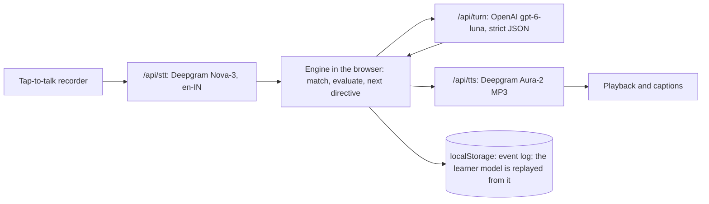

# Vocab Coach

A working prototype of a voice agent that helps people learn vocabulary: it turns words you half-know into words you actually say.

It is built for Indian adults (18+) preparing for IELTS, PTE or DET speaking at roughly B1 to B2. You talk with a coach; it introduces a word in conversation, asks for it again a few minutes later with a ladder of hints, and brings it back on later days when a spaced-repetition scheduler says it is due. Code decides what to teach, when to test and what counts as learnt; the AI writes the words and judges whether a word was used well.

## Try it in 3 minutes

1. Open the app, tick **I am 18 or older**, and choose **Try with demo history**. You get a learner with six words: three due now at different levels, two still learning, and one a single success away from mastery.
2. **Start a session** (voice or typing). When the coach asks a question that needs a word, say or tap **I don't know**. Watch the hint ladder: a meaning cue, the first sound, a choice of two, then the word. The chip under the microphone never shows the word before the choice.
3. Open **Under the hood** (under the header) to see the engine's state, the directive, the matcher result, the AI's judgement, latency and cost. After the session, press **+3 days** and watch words come due; **Reset** puts the clock back.

The **About** page explains the problem, the loop and the first experiment to run.

## How it works



- **Seed, Stretch, Spiral.** A new word is seeded in conversation (meaning and one phrase from a curated list, then your own sentence). Two to four minutes later a question needs it (Stretch). On later days, words that FSRS marks as due return in a new context (Spiral).
- **Evidence ladder.** Each attempt is graded: recalled with a hint (2), recalled (3), used in a sentence (4), used on your own (5). Mastery needs level 4 on two days, a level-5 use, and a success at least 7 days after you first met the word.
- **Scheduling.** FSRS-6 via `ts-fsrs`, desired retention 0.90, no fuzz, whole days only. Only the first scheduled outcome per word per day updates FSRS; everything else is evidence.
- **The event log is the source of truth.** Every action is appended to a local log; the learner model is rebuilt by replaying it, so finalising a session, recovering a closed tab and resetting the demo clock are all just replays.

### Code layout

| Path | What it holds |
|---|---|
| `src/engine/` | Pure TypeScript, no React, no I/O, no clock: lexicon, matcher, intent, outcome table and ladder, FSRS adapter, replay, planner, session state machine, guards, templates, demo history. A lint rule bans `Date.now()`, argument-less `new Date()`, `Math.random()` and `performance.now()` here. |
| `src/server/` | Env validation, HMAC session token, zod schemas, the prompt, the turn guards, and provider adapters (`providers/stt.ts`, `llm.ts`, `tts.ts`). |
| `src/app/api/` | The four stateless routes: `session`, `stt`, `turn`, `tts`. |
| `src/client/` | Versioned localStorage store, clock, API client, recorder, streaming player, and the session controller that wires engine, routes and audio. |
| `src/components/`, `src/app/` | Screens: start, onboarding, home, session, recap, notebook, settings, about; Under the hood and the clock banner. |
| `src/data/` | The 40-word lexicon and the Indian English allowlist (both drafts; see `LEXICON_REVIEW.md`). |
| `src/config/` | All tunable numbers (`defaults.ts`) and the prices behind the cost meter (`pricing.ts`). |
| `docs/` | The brief, the research, the latency pass and the QA record. `PLAN.md` holds every design decision; `CHANGES.md` holds proposals awaiting approval. |

## Setup

Requirements: Node 24, npm, a Deepgram account and an OpenAI API key on a project with billing.

```bash
npm install
cp .env.example .env.local
```

Fill in `.env.local`, then:

```bash
npm run dev
```

and open http://localhost:3000.

### Environment variables

| Name | Required | Default | What it is |
|---|---|---|---|
| `DEEPGRAM_API_KEY` | yes | | Speech-to-text and text-to-speech |
| `OPENAI_API_KEY` | yes | | The conversation and the judge. Use a project with billing and a budget limit |
| `SESSION_SECRET` | yes | | 32+ random characters for signing session tokens: `openssl rand -base64 32` |
| `LLM_MODEL` | no | `gpt-6-luna` | OpenAI model ID |
| `LLM_REASONING_EFFORT` | no | `none` | `none`, `low`, `medium` or `high` |
| `STT_MODEL` | no | `nova-3` | Deepgram pre-recorded model |
| `STT_LANGUAGE` | no | `en-IN` | Deepgram language code |
| `TTS_VOICE` | no | `aura-2-harmonia-en` | One of `aura-2-draco-en`, `aura-2-pandora-en`, `aura-2-harmonia-en` |
| `VOICE_ENABLED` | no | `true` | `false` turns off speech in and out; sessions run as typing with captions |

Secrets stay on the server. `npm run build` fails if any secret value appears in the client output.

### Scripts

| Command | What it does |
|---|---|
| `npm run dev` | Local development server |
| `npm run build` | Production build, then the secret check |
| `npm run check` | Type check, lint and the full test suite |
| `npm test` | Unit, replay, route and controller tests (no provider calls) |
| `npm run smoke [URL]` | Hits every route against real providers and prints latencies (needs a running server) |
| `npm run eval:latency` | 20-turn latency pass plus an LLM streaming test (`LATENCY_BASE` sets the server) |
| `npm run eval:judge` | 30 labelled sentences through the real judge; reports agreement and kappa |
| `npm run lexicon:review` | Regenerates `LEXICON_REVIEW.md` from the data |
| `npm run voices:render` | Renders the three candidate voices to `samples/voices/` |

### Deploy to Vercel

1. Import the repository in Vercel (or run `vercel` from this folder). Functions run in `iad1`, next to the speech and LLM providers (`vercel.json`; see `docs/LATENCY.md`).
2. Add the environment variables above in the project settings. Use a fresh `SESSION_SECRET`.
3. Set spend limits or budget alerts at Deepgram and OpenAI. Without a rate-limit store, provider spend caps are the only volume limit.
4. Deploy, then run `npm run smoke https://<your-app>.vercel.app` and `LATENCY_BASE=https://<your-app>.vercel.app npm run eval:latency`.

## Decisions and why

| Decision | Why |
|---|---|
| Cascaded speech-to-text, then LLM, then text-to-speech | The transcript is the learning record, and deterministic checks run before the agent replies |
| Tap to talk, not voice activity detection | Learners pause mid-sentence; tap-to-talk also avoids laptop speaker echo |
| A dedicated speech recogniser, never the LLM, and no keyword boosting | An LLM can quietly fix errors or "hear" the expected word; boosting can make the recogniser hear targets that were never said |
| Code decides what is learnt and when; the AI only writes and judges | Scheduling and mastery stay testable and consistent |
| No target word shown or spoken before the third hint | Showing it turns recall into recognition. Home shows a count of due words, never the words |
| Learner state in this browser only, no accounts | Zero setup for reviewers, and nothing personal stored on a server |
| OpenAI `gpt-6-luna` for the LLM, Deepgram for speech | Your choice of OpenAI (D16); OpenAI's speech APIs give no per-word confidence and its text-to-speech models retire on 6 Jan 2027 |
| Event log replayed into the model | Finalise, tab recovery and the demo clock become the same operation, and replay identity is testable |

Every resolved ambiguity in the brief is listed, numbered and approved in `PLAN.md` §10.

## Research numbers versus prototype defaults

| Setting | Research | Prototype | Why it differs |
|---|---|---|---|
| Speech-to-text | Deepgram Flux, streaming | Deepgram Nova-3 pre-recorded, `en-IN` | Tap-to-talk sends a finished clip; Nova-3 supports Indian English |
| LLM | Gemini 3.8 Flash | OpenAI `gpt-6-luna`, reasoning `none` | Your instruction (D16) |
| Text-to-speech | Cartesia Sonic or Aura-2 | Aura-2, MP3 | The brief's choice |
| Session length | 10 minutes, 15-minute cap | 6 minutes first, 10 later, hard cap 10 | Brief §14 |
| New words per session | 2 to 3 per 10 minutes | 2 in the first session, up to 3 later; none if more than 8 are due | Same rule |
| Hints | Triggered by silence over 6 s or "I don't know" | Only "I don't know" or not using the word | No reply timers (accessibility) |
| Missed review | Level drops to max(level − 1, 2) | Only from level 3 up; below that unchanged | Brief's pinned rule, so a just-seeded word can't jump to level 2 |
| Judge | After the session, against 300 human labels, kappa at least 0.8 | In the same call as the reply; 30-case eval | Prototype scope |
| Latency target | Under 1.0 s p50, under 1.8 s p95, voice to voice | 2.5 s p50, 4 s p95 to first audio | Tap-to-talk; not yet met (see limitations) |
| Cost per session-minute | $0.027 to $0.038 (estimate) | Measured per session in Under the hood | The prototype prices what it actually used (`src/config/pricing.ts`) |
| Storage | PostgreSQL | localStorage | No accounts or server database |

## Known limitations

- **Latency.** From India against a local server, the end of a turn to first audio measured 5.2 s at p50 and 9.6 s at p95, against a 2.5 s target. Most of it is distance to Deepgram's US servers and the LLM's own time. Deploying to `iad1` should help; `CHANGES.md` proposes streaming the reply into speech (C1) and, if needed, streaming speech recognition (C2). Details in `docs/LATENCY.md`.
- **Voice not yet tried on real devices.** Typing mode is verified end to end; recording, barge-in and Space-to-talk are covered by tests with fake audio, and need a run on Safari, iPhone and Android (`docs/QA.md`).
- **The word list and judge cases are drafts.** All 40 words and the 12 allowlist entries are `reviewed: false` until approved; levels and frequency bands are estimates. The judge agreed 100% with 30 clear-cut labelled sentences, which shows it works but not that it catches subtle errors.
- **Speech recognition is weaker on Indian-accented English** (research §9). When it is unsure about a target word, the coach asks once, then changes nothing for that word.
- **FSRS was fitted to flashcard self-grades.** Mapping spoken evidence onto it is a hypothesis, as is the whole approach's advantage over flashcards.
- **No volume limit beyond spend caps.** Session tokens limit a session's length, not how many sessions a script can start.
- **Privacy.** Audio isn't stored and progress stays in the browser. Speech is transcribed by Deepgram (opted out of model improvement), and text is sent to OpenAI to write replies (not stored, but OpenAI may keep API text up to 30 days for abuse monitoring).
