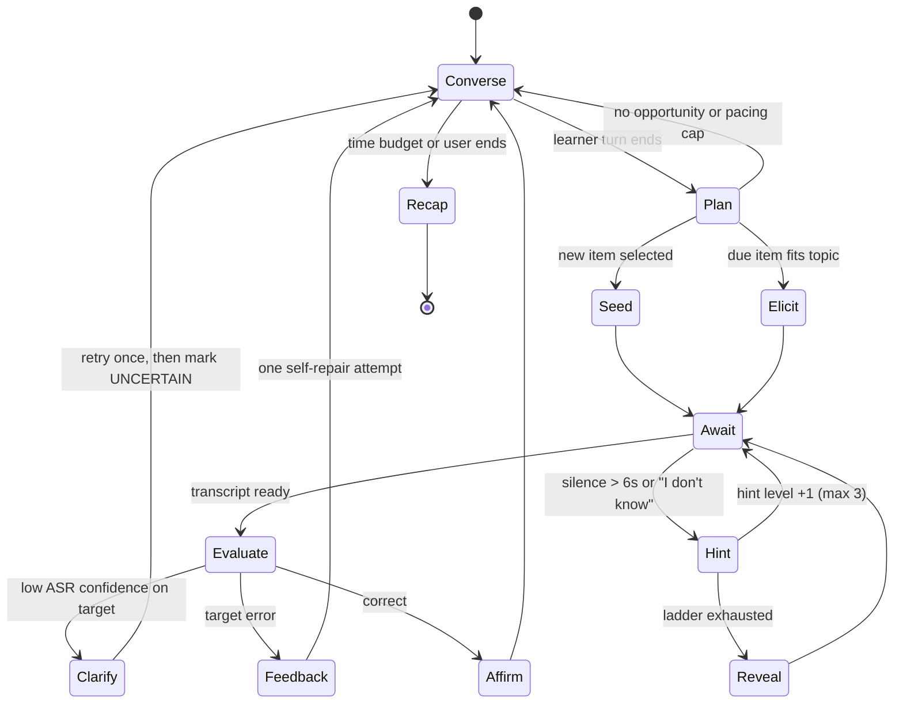
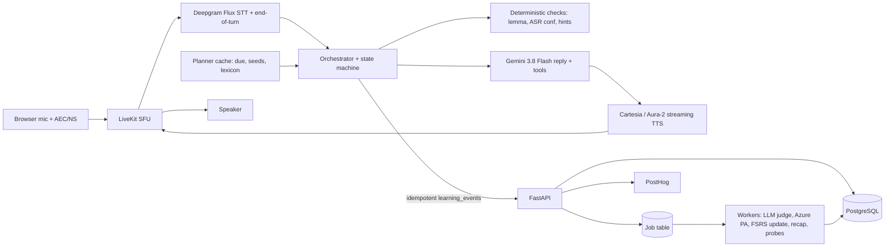

# AI Voice Agent for Vocabulary Learning: Research-Backed Blueprint (October 2026)

**Process note:** the final enrichment pass (`enrich_draft`) never ran. Every submission was over its 50,000-character limit, by 885 characters on the last try, and the turn budget ran out first. So no enricher substitutions were applied. Claims marked "secondary" or "unverified" below were not checked against a named source in that pass.

Build it, but narrowly. The product should turn words a learner half-knows into words they actually say. It is for Indian adults (18+) preparing for English speaking tests (IELTS, PTE, DET) at about B1 to B2. Run the MVP on a cascaded pipeline (speech-to-text, then an LLM, then text-to-speech), with a deterministic learner model and an FSRS review scheduler. Do not compete on general "AI conversation", which is already commoditised.

## TL;DR

- **Opportunity and segment:** AI conversation already exists in Duolingo Max, Speak, Praktika, Stimuler, TalkPal and ChatGPT. What is missing is a persistent loop that tracks which words a learner can *produce* and brings them back for spaced spoken retrieval.
  - Start with Indian IELTS/PTE/DET candidates aged 18+. They face a deadline, are scored on lexical range, and already pay: Stimuler's Indian App Store prices run from ₹149 a week to ₹1,999 a year.
  - The 18+ limit avoids India's DPDP verifiable parental consent rules, which apply from May 2027.
- **Architecture and cost:** Cascaded MVP: Deepgram Flux for speech-to-text, Gemini 3.8 Flash for reasoning, Cartesia Sonic or Deepgram Aura-2 for speech, orchestrated by LiveKit Agents.
  - Estimated cost is $0.027 to $0.038 per session-minute. Over 30 days that is about $4 to $6 a month for a light user (5 min/day) and $24 to $34 for a heavy user (30 min/day).
  - Gemini 3.8 Live is cheaper per minute on headline prices. It must first be measured for context billing and transcript fidelity.
- **Biggest risks:**
  - Indian price points (₹199 to ₹999 a month) barely cover heavy voice use, so voice minutes must be capped.
  - Speech recognition is measurably worse on Indian-accented English. On the Svarah benchmark, commercial Google and Azure en-IN models had about 21% word error rate (WER), against 7.2% for Whisper-large.
  - There is no evidence yet that spoken retrieval beats flashcards, which are among the most effective intentional methods. The first experiment must test exactly this.

## Assumptions and conventions

- **Markets:** India is the primary candidate market. This is an assistant default because the user is India-based; US, UK and EU English learners are secondary. The segment choice rests on evidence, not on this default.
- **Currency:** Provider prices are in USD, taken from official pricing pages or from secondary sources quoting them, accessed 20 to 26 October 2026. INR conversions use **₹95.2 = $1** (Trading Economics quoted 95.22 on 26 October 2026).
- **Cost basis:** 30 active days a month, which is an upper bound. For 20 active days, multiply by 0.67.
- **Labels:**
  - "verified" = official page or primary paper;
  - "secondary" = a third party's reading of an official page;
  - "hypothesis" = a product judgement still to be validated.

---

## 1. Executive summary

**Opportunity.** Intermediate learners recognise far more words than they can retrieve when speaking under pressure, and intentional study decays fast.
- Webb, Yanagisawa and Uchihara's 2020 meta-analysis (22 studies, 100 effect sizes) found average gains of 60.1% on immediate meaning recall. On delayed tests these fell to 39.4% for meaning and 25.1% for form.
- Spaced retrieval (Cepeda et al. 2006; Karpicke and Roediger 2008) has strong, durable support, and so does oral corrective feedback (Lyster and Saito 2010).
- No mainstream product combines spaced retrieval of *productive* vocabulary with natural spoken conversation and a transparent per-word mastery record.

**Target user.** Indian adults preparing for IELTS, PTE or DET speaking, currently around band 5.5 to 6.5 and aiming for 6.5 to 7+.

**Solution: "Vocab Coach".** A 10-minute voice companion that:
- introduces ("seeds") 2 to 3 target words per session inside natural conversation;
- asks the learner to retrieve and use them aloud;
- corrects selectively;
- records graded evidence for each word;
- schedules reviews with FSRS;
- ends with a 60-second spoken recap and a visual notebook.

**Key risks:**
- unit economics at Indian prices;
- bias in speech recognition and pronunciation scoring;
- no proven advantage over flashcards;
- a crowded market, led in India by Stimuler;
- rules on children's data;
- definitions invented by the LLM.

## 2. Problem validation

| Problem | Evidence | Implication |
|---|---|---|
| Forgetting after intentional study | Webb et al. 2020: 60.1% immediate vs 39.4% delayed meaning recall; delayed form recall 25.1% | Measure delayed recall; schedule spaced retrieval |
| Incidental exposure is slow | Uchihara, Webb and Yanagisawa 2019 (26 studies, N = 1,918): repetition has a medium effect (r = .34), moderated by spacing, engagement and prior vocabulary | Conversation alone is not enough; deliberately engineer repeat encounters |
| Flashcards work | Webb et al. 2020: flashcards 77.0% and word lists 73.2% on immediate meaning recall, beating writing and fill-in-the-blanks | The product must beat or complement flashcards, and be tested against them |
| Word knowledge has several dimensions | Nation: form, meaning and use, each receptive and productive | Track recognition, recall, use and appropriateness separately |
| Deeper processing helps | Laufer and Hulstijn 2001 (involvement load: need, search, evaluation) | Make the learner *need* the word in a task |

**Understanding vs use.** Recognising "mitigate" is not the same as retrieving it unprompted with the right collocation ("mitigate the risk"). Only spontaneous, appropriate use in a new context counts as mastery.

**Scope.**
- **In:** words, collocations, phrasal verbs, fixed expressions, register alternatives.
- **Out of V1:**
  - fluency coaching and grammar curricula;
  - accent modification;
  - band prediction;
  - writing and other languages;
  - A1 to A2 beginners and under-18s;
  - unlimited free chat.
- **Pronunciation** is handled only where it affects whether a target word is intelligible (Munro and Derwing 1995; Levis 2005).

**Most valuable initial problem:** "I know the word when I see it, but it doesn't come out when I speak."

**Segment comparison.** Scores are judgements from 1 to 5, where 5 is most favourable.

| Segment | Severity | Willingness to pay | Frequency | Reach | Low competition | Note |
|---|---|---|---|---|---|---|
| General ESL | 3 | 2 | 3 | 5 | 1 | Saturated |
| **Exam candidates, India** | **5** | **4** | **5** | **4** | **2** | Lexical Resource is one of four IELTS speaking criteria; Stimuler's pricing shows paid demand |
| Professionals | 3 | 4 | 2 | 3 | 3 | B2B later |
| Job seekers | 4 | 3 | 3 | 4 | 3 | Second segment |
| "Understand but can't express" | 5 | 3 | 3 | 4 | 2 | The exam segment's core pain |
| Advanced precision | 2 | 3 | 2 | 2 | 4 | Hard to evaluate; risk of LLM errors on nuance |

**Recommendation: exam candidates in India, 18+.** Caveat: no public data measures willingness to pay specifically for vocabulary, so validate it with a pre-sale.

## 3. Competitive landscape

Prices were verified where stated. Features marked "unverified" come from prior product knowledge.

| Product | Method | Voice | Vocabulary memory | Feedback | Price (USD; INR where published) |
|---|---|---|---|---|---|
| Duolingo Max | Gamified course plus Video Call and Roleplay | Yes; reviewers say calls are short and there is no pronunciation scoring | Course-level only | Explain My Answer (free since Jan 2026, per reviewers) | $29.99/mo or $167.99/yr US (secondary). One reviewer found Max not offered on iOS in Sept 2026 (conflict) |
| ELSA Speak | Pronunciation drills | AI role-plays | Weak, per user complaints | Phoneme-level | $89.99 to $99.99/yr; India ₹499 to ₹599/mo per third parties (conflicting) |
| Speak | Lessons plus AI tutor | High quality; American English only | Partial | After-turn corrections | $17.99/mo or $83.99/yr, US App Store (secondary) |
| Praktika | Avatar tutors | Yes | Daily plan | Soft, balanced or strict modes | $9.99/mo (secondary) |
| Stimuler | Indian IELTS coach "Sarah" plus mock tests | Yes | Reports; no retention system | Fluency, grammar, vocabulary, pronunciation | India ₹149/wk, ₹199 to ₹399/mo, ₹499 to ₹1,999/yr; US $6.99 to $29.99/mo (verified, App Store) |
| TalkPal | Multi-language role-play | Yes | Limited | Grammar | $9.99/mo on annual plan; free 10 min/day (secondary) |
| ChatGPT voice | General | GPT-Live-1, full-duplex | No learner model | Only on request | Bundled with ChatGPT plans |
| Babbel, Memrise, Busuu, Quizlet, Anki, Vocabulary.com, WordUp | Courses or flashcards | Partial or none (unverified) | Review and scheduling (Anki uses FSRS) | Basic | Not re-verified |
| Hello English, SpeakX, TalkDrill, Loora, Langua, Google Translate practice | Niche speaking practice | Varies | Langua saves flashcards (unverified) | Varies | TalkDrill ₹299 to ₹799/mo (its own blog) |

**Gaps the evidence supports:**
- No reviewed product shows a per-word record of *spoken* productive use, verified over time.
- Reviewers say Speak's course, conversation and review are disconnected, and that Duolingo Max's AI conversation is comparable to free tools.
- Indian learners must choose between USD-priced premium apps and local apps that only give feedback.

**Already commoditised:** role-play conversation, generic grammar correction, pronunciation scores, IELTS mock tests, avatars.

**Differentiation:**
1. Spaced spoken retrieval across sessions.
2. A graded evidence ladder for each word.
3. A 7-day delayed-recall "proof" report.
4. Accent-fair evaluation based on intelligibility.
5. Definitions grounded in a curated lexicon.

**Positioning options:**
- (a) "The Anki of speaking";
- (b) "Lexical Resource coach for IELTS speaking";
- (c) "Say it at work".

**Recommended: (b).** *For Indian IELTS and PTE candidates who understand English but freeze when choosing words, Vocab Coach is a 10-minute daily voice coach that turns words you half-know into words you actually say, and proves it a week later.*

**Gap in user research.** A systematic pass through Reddit (r/EnglishLearning, r/IELTS, r/Anki and others) was not completed. The complaints above come from reviews and app-store comments, which are anecdotal. Code about 200 posts before building.

## 4. Learning-science framework

Evidence status: E = established, M = moderate or emerging, H = hypothesis.

| Method | Evidence | Voice implementation | Limitation | Measure | Status |
|---|---|---|---|---|---|
| Spaced repetition | Cepeda et al. 2006: distributed practice beats massed. FSRS predicts recall better than SM-2 in 99.6% of ~10k Anki collections (open benchmark) | FSRS schedules each item; due items are woven into prompts | Benchmark measures flashcard prediction and was built by the FSRS team | Recall at day 7 and day 30; calibration | E / M |
| Retrieval practice | Karpicke and Roediger 2008; Dunlosky et al. 2013 rate practice testing "high utility" | Ask for the word before saying it; ladder of hints | Failed retrieval frustrates | Cued vs free recall | E |
| Context plus explicit focus | Repetition r = .34 (incidental learning); flashcards strong (intentional learning) | A sentence from the learner's own context, then the learner's own sentence | Context alone is slow | Use in a new context | E |
| Graded input | Lexical coverage research (Nation) | At most one unknown target per agent utterance | Level estimates are noisy | Learner requests for clarification | E / H |
| Interleaving | Strongest for discrimination tasks; mixed for vocabulary | Mix due items across topics | Can feel incoherent | Errors on near-synonyms | M |
| Elaboration and word families | Involvement load; clustering synonyms can cause interference | Never seed confusable words together | Interference | Errors on confusable pairs | M |
| Pronunciation and discrimination | Munro and Derwing 1995: intelligibility is not the same as accentedness | Minimal pairs only when a misrecognition changes meaning | ASR errors look like learner errors | Intelligibility of target words | E |
| Immediate vs delayed feedback | Li 2010: overall effect about d = 0.6; implicit feedback is better sustained | Live prompts on target words; everything else in the recap | Delay loses salience | Experiment 2 | M |
| Correction that preserves confidence | Lyster and Saito 2010 (15 studies, N = 827): durable effects; prompts beat recasts. Lyster and Ranta 1997: recasts often go unnoticed | Prompt self-repair ("Close, can you find a stronger verb?") | Overcorrection silences learners | Talk time; repair rate | E / H |
| Transfer | Varied retrieval contexts | Each retrieval in a new scenario | Hard to assess automatically | Spontaneous use on an unseeded topic | M / H |
| Long-term measurement | Delayed tests reveal decay (Webb et al. 2020) | Unannounced probes at day 7 and day 30 | Probe fatigue | Delayed form recall | E |

**Framework: Seed, Stretch, Spiral.**
1. **Seed** (90 s or less): the agent uses the word in context, gives a plain meaning and one collocation, then the learner makes their own sentence.
2. **Stretch:** 2 to 4 minutes later, a question requires the word. Hints escalate: meaning cue, then first sound, then a choice of two, then reveal.
3. **Spiral:** words that FSRS marks as due come back in new scenarios. A word is promoted only after an unhinted success on a different day.

**Correction rules:**
- Correct target words live, using prompts.
- Defer at most 2 other errors to the recap.
- Never correct legitimate dialect forms.

**Pacing** (2 to 3 new items per 10 minutes, at least 50% of time on retrieval) is a hypothesis to tune.

## 5. Product specification

**Interaction styles.**
- **Tutor-led:** predictable but feels like a class. Use it for a pre-exam "Sprint".
- **Free-flowing:** engaging, but retrieval is not guaranteed. Use it on low-energy days (due words only).
- **Hybrid (default):** the planner guarantees due retrievals and at most 3 seeds, while the learner chooses topics.

**Sample transcripts (condensed).**

A. *New word:*
> **Agent:** You mentioned last monsoon's floods. Councils try to *mitigate* flood damage, meaning make it less severe. People say "mitigate the risk". How would you use it?
> **Learner:** The government should mitigate the flood?
> **Agent:** Nearly. We mitigate the *damage*, not the flood. Try again?
> **Learner:** The government should mitigate flood damage by cleaning drains.
> **Agent:** Perfect. Does your area get waterlogged?

B. *Through conversation:*
> **Learner:** One and half hour commute, very tiring.
> **Agent:** An hour and a half sounds *gruelling*, exhausting over time. Where's the worst *bottleneck*?
> **Learner:** The bottleneck is near the flyover; it's gruelling daily.

Both seeds are logged as prompted use. "One and half hour" is deferred to the recap.

C. *Correction without derailing:*
> **Learner:** I will do a discussion with my manager; we preponed it.
> **Agent:** Got it, you'll *have* a discussion. What's it about?

"Prepone" is standard Indian English, so it is not corrected. The recap offers "brought forward" as an international option, not as an error.

D. *Forgotten word:*
> **Agent:** What word did we use for someone extremely careful with details?
> **Learner:** I forgot.
> **Agent:** It starts "me-ti…"
> **Learner:** Meticulous! My sister is meticulous about prescriptions.

Logged as cued recall, with FSRS rating "Hard".

E. *Interview simulation:*
> **Learner:** I mitigated the risk by asking help early.
> **Agent (stepping out of role):** "Mitigated the risk", used on your own, goes in your notebook. Small one: "asking *for* help". Back in role: what was the outcome?

F. *Nuance:*
> **Agent:** "Issue" is often more neutral or formal; "problem" can sound more negative. Usage varies. Your manager asks about a delay: which fits?
> **Learner:** "There's an issue with the vendor."
> **Agent:** That's how most professionals would say it.

G. *Pronunciation:*
> **Learner:** I feel com-FOR-table now.
> **Agent:** I understood you fine. Most speakers say COMF-ta-ble. Want to try?

The word was intelligible, so this is advisory only and nothing is logged against mastery.

H. *Recap (60 s):*
> **Agent:** You learned *gruelling* and *bottleneck* and used both. *Meticulous* needed a hint, so we'll revisit it Thursday. Big win: you said *mitigate the risk* on your own. One phrase to polish: "an hour and a half". Three words are due tomorrow.

**User journey:**
1. Landing page ("Words you can say, proven in 7 days").
2. Sign-up with 18+ confirmation.
3. Goals: exam, date, target band, interests.
4. A 4-minute conversational calibration.
5. A first 6-minute session with 2 seeds.
6. Recap and notebook.
7. Reminder at a time the learner chooses.
8. Return sessions: due words plus new seeds.
9. Weekly day-7 proof report.
10. Exam-countdown plan.

**UX defaults.**
- **Turn-taking:** tap to talk, with patient end-of-turn detection (at least 1.2 s of silence plus a semantic end-of-turn check), a push-to-talk toggle, and interruption ("barge-in") support. L2 speakers pause mid-sentence, and Indian homes and commutes are often noisy (hypothesis).
- **Live transcript:** faint and collapsible. It also exposes recognition errors.
- **Corrections:** spoken for target words; deferred items appear on screen.
- **Progress:** counts of words "used on your own" and "still used after 7 days", not streaks.
- **Accessibility:** speech rate 0.8 to 1.2×, text fallback, captions, no reply timers.

**Wireframes.**
- **Home:** start button, "3 words due", exam countdown.
- **Session:** microphone orb showing state, faint transcript, target-word chip, "I don't know" and "repeat slower" buttons.
- **Recap:** words with evidence badges, one item to polish, next due dates.
- **Notebook:** filters, meaning, the learner's best sentence, history, "practise now".
- **Progress:** words reaching level 5 each week, day-7 retention.
- **Privacy:** audio toggle (off by default), export, delete all.

## 6. Agent design



**Failure handling:**
- **Speech-to-text fails:** apologise once and offer text input.
- **LLM takes longer than 2.5 s:** play a cached filler phrase and switch to a fallback model.
- **Text-to-speech fails:** show the text instead.
- **Recognition confidence stays low:** stop grading target words and log the attempt as UNCERTAIN, not as a failure.
- **Signs of frustration:** switch to free talk with no new seeds.

**What is deterministic and what the LLM does.**
- **Deterministic code:**
  - which items are due, and pacing;
  - whether the target word was produced (lemmatiser, inflections, ASR word confidence);
  - hint level;
  - evidence promotion and FSRS rating mapping;
  - the dialect allowlist.
- **LLM:**
  - conversational replies;
  - judging semantic and collocational appropriateness (against a rubric, with structured output and a confidence score);
  - paraphrasing lexicon entries.
- **Curated lexicon only:** definitions, collocations and etymologies presented as facts.

**System prompt (abridged):**
```
You are Vocab Coach, a warm, concise English speaking partner for adults preparing for
IELTS/PTE/DET speaking. Goal: help the learner USE target words, not lecture.
1. 1–3 sentences per turn (≤40 words), one question at a time, at level {cefr}.
2. Only use targets in <targets>. SEED: use naturally, meaning ≤12 words, one collocation
   from <lexicon>, invite the learner's sentence. DUE: ask a question that requires the
   word; never say it first; call request_hint() for help, never skip levels.
3. Definitions/collocations must come from <lexicon>. Otherwise say you are not certain.
   Never invent etymologies.
4. Correct only target-word errors live, by prompting self-repair. Others: light recast or
   defer_note(). Max one correction per learner turn.
5. Accents and regional varieties (Indian, British, American, Nigerian English...) are not
   errors. <dialect_allowlist> items are correct.
6. Never shame; praise specifics; if frustrated, set_mode("free_talk").
7. After any turn containing or needing a target, call report_attempt(). You do not decide
   mastery. You are an AI; do not predict exam bands or request sensitive personal data.
<learner_profile/> <targets/> <lexicon/> <dialect_allowlist/> <session_state/>
```

**Evidence ladder and FSRS mapping:**

| Level | Evidence | FSRS rating |
|---|---|---|
| 0 Exposed | Agent introduced the word | Card created |
| 1 Recognised | Learner identified the meaning | Hard |
| 2 Cued recall | Produced after hint 1 or 2 | Hard (Again if hint 3 or reveal was needed) |
| 3 Free recall | Produced with no hint | Good |
| 4 Prompted use | Correct sentence when asked | Good |
| 5 Spontaneous use | Used unprompted and appropriately | Easy |
| ★ Mastered | Level 4 or higher on two different days, at least once at level 5, last success at least 7 days after first exposure | n/a |

- A missed review drops the level to max(level − 1, 2).
- An UNCERTAIN result never changes the level.
- Only the first scheduled outcome per item per day updates FSRS.

**Scheduler choice.**
- **Leitner boxes:** used as the control arm.
- **SM-2:** dropped, because it predicts recall less well and suffers from "ease hell".
- **Duolingo half-life regression** (Settles and Meeder 2016): needs large datasets (benchmark AUC 0.63).
- **FSRS-6 (default):** default parameters, desired retention 0.90, optimised per user once enough history exists.

Caveat: FSRS was fitted to flashcard self-grades, so mapping spoken evidence onto it is a hypothesis. Check calibration by week 8.

**What to teach next (weights are a hypothesis):**

`priority = 0.35·(1−R) + 0.20·goal_relevance + 0.15·usefulness + 0.10·interest + 0.15·error_history − 0.15·|difficulty−level|`

Rules:
- Due items come first.
- At most 3 seeds per 10 minutes.
- Never seed confusable words on the same day.
- Skip new seeds if more than 8 items are due.

**Seven-day example ("mitigate"):**
- **Mon:** seeded; prompted use after self-repair. Level 4, due Tuesday.
- **Tue:** needed the first-sound hint. Rated Hard, level 2, due Thursday.
- **Thu:** free recall with "mitigate the impact". Rated Good, level 4, due Monday.
- **Fri:** spontaneous use in an interview role-play. Level 5, counted as bonus evidence.
- **Mon:** delayed probe on a climate topic succeeds. Stability about 10 days; mastery pending until 7 days have passed since first exposure.

**Schemas (compact JSON):**
```json
{"vocabulary_item":{"item_id":"lex_mitigate_v","lemma":"mitigate","pos":"verb","cefr":"C1","senses":[{"definition_simple":"make something bad less severe","source":"licensed_dict"}],"collocations":["mitigate the risk"],"ipa_gb":"ˈmɪtɪɡeɪt","confusables":["militate"],"inflections":["mitigated","mitigating"]}}
{"attempt":{"item_id":"lex_mitigate_v","elicitation":"retrieval_question","hint_level":0,"transcript_span":"mitigate the damage","asr_conf_min":0.91,"lemma_present":true,"llm_judgement":{"appropriate":true,"confidence":0.82},"outcome":"correct|incorrect|uncertain"}}
{"learning_event":{"idempotency_key":"sess:turn:attempt","ts":"2026-10-26T10:15:03Z","item_id":"lex_mitigate_v","type":"free_recall","level_before":2,"level_after":3,"fsrs_rating":"Good"}}
{"review_recommendation":{"due":[{"item_id":"lex_meticulous_adj","retrievability":0.71,"priority":0.64}],"seeds":[{"item_id":"lex_bottleneck_n","reason":"goal+interest"}],"max_seeds":3}}
{"session_summary":{"duration_s":612,"learned":["lex_gruelling_adj"],"retrieved":[{"item_id":"lex_meticulous_adj","result":"cued_recall","next_due":"2026-10-29"}],"spontaneous":["lex_mitigate_v"],"polish":[{"said":"one and half hour","suggest":"an hour and a half"}],"uncertain":[]}}
```

## 7. Technical architecture

| Layer | Choice | Why |
|---|---|---|
| Client | Next.js + TypeScript PWA | Fast iteration; WebRTC in the browser |
| Real-time runtime | LiveKit Agents (Python) on LiveKit Cloud; Pipecat as alternative | Turn detection and barge-in (pricing not verified) |
| Speech-to-text | Deepgram Flux; Nova-3 as fallback | Conversational end-of-turn detection; must win the Indian-accent bake-off |
| LLM | Gemini 3.8 Flash; Batch/Flex tiers for async work | $0.75 input / $3.75 output per 1M tokens until 31 Dec 2026, then $1.50 / $7.50 (official) |
| Text-to-speech | Cartesia Sonic 3.6 or Deepgram Aura-2 | Low latency; about $30 to $40 per 1M characters |
| Pronunciation | Azure Pronunciation Assessment, en-IN locale, on target-word clips only | Only service found offering phoneme scores with an en-IN locale |
| API, jobs, database | FastAPI; job table in Postgres (SKIP LOCKED); managed PostgreSQL | Relational state plus JSONB events; **no vector database needed** |
| Auth, analytics, monitoring | Managed auth with phone OTP; PostHog; OpenTelemetry + Sentry | Low effort; experiments built in |



**Synchronous vs asynchronous work.**
- **During each turn:** end-of-turn detection, speech-to-text, deterministic checks, LLM reply, text-to-speech, writing a provisional event.
- **After the session:**
  - LLM appropriateness judging (which can downgrade provisional credit);
  - pronunciation scoring;
  - committing FSRS updates;
  - recap and notebook;
  - probes and reminders;
  - analytics.

**Repository layout:**
- `apps/web`
- `services/agent` (pipeline, state_machine, tools, prompts)
- `services/api` (routers; learner_model with evidence, fsrs_adapter, planner, dialect; jobs)
- `packages/lexicon`
- `packages/schemas`
- `evals` (accent audio, judge test cases)
- `infra`

**Database schema (key tables):**
```sql
users(id pk, age_confirmed_18 bool, exam, exam_date, target_band, cefr, interests text[],
      audio_retention bool default false, deleted_at)
lexicon_items(id pk, lemma, type, pos, cefr, freq_band, lists text[], entry jsonb, version)
learner_items(user_id fk, item_id fk, evidence_level, mastered, fsrs_stability, fsrs_difficulty,
      last_review, due_at, first_seen, last_success, miss_count, best_sentence, common_errors jsonb,
      pk(user_id,item_id)); index(user_id, due_at)
sessions(id pk, user_id fk, started_at, ended_at, mode, status, summary jsonb, experiment_arms jsonb)
turns(id pk, session_id fk, idx, speaker, text, asr_meta jsonb, latency_ms, expires_at)  -- 90-day TTL
learning_events(id pk, idempotency_key unique, user_id, item_id, session_id, type, payload jsonb, created_at)
jobs(id pk, kind, payload jsonb, run_after, attempts, status, locked_at)
```

**API endpoints:**
- `POST /v1/sessions` (returns a LiveKit token and the session plan)
- `POST /v1/sessions/{id}/end`
- `GET /v1/sessions/{id}/summary`
- `POST /v1/events` (idempotency key required)
- `GET /v1/reviews/plan`
- `GET /v1/notebook`
- `GET/PATCH /v1/me`
- `POST /v1/me/export`
- `DELETE /v1/me`
- `POST /v1/probes/{id}/result`

**Audio flow:**
1. `getUserMedia` with echo cancellation and noise suppression, sent over WebRTC.
2. Flux returns partial transcripts and an end-of-turn signal.
3. Deterministic checks run, and the prompt is built with a cached prefix (system prompt, lexicon, profile).
4. The LLM streams its reply; the first sentence goes straight to text-to-speech.
5. On barge-in, playback stops (target under 300 ms) and the agent's history is cut to what was actually spoken.

**Core pseudocode:**
```python
async def run_session(room, user):
    plan = await api.review_plan(user.id); sm = StateMachine(plan)
    async for turn in stt_stream(room):                    # yields on end-of-turn
        if turn.barge_in: tts.stop(); history.truncate_unspoken()
        att = None
        if sm.awaiting_item:
            att = check_lemma(turn, sm.awaiting_item)       # lemma, inflections, ASR conf
            if att.asr_conf_min < 0.6: att.outcome = "uncertain"
            await api.post_event(att.event(), idem=f"{sm.sid}:{turn.idx}")
        directive = sm.next(att)                            # seed/elicit/hint/feedback/converse/recap
        try: reply = await llm.stream(prompt(history, plan, directive), timeout=2.5)
        except (Timeout, RateLimit): await tts.say(FILLER); reply = await fallback.stream(...)
        async for s in reply.sentences(): await tts.speak(s)
        for c in reply.tool_calls: await handle_tool(c, sm)
        if sm.done: break
    await api.end_session(sm.sid)                           # enqueues judge, FSRS, recap

def finalise(session_id):                                   # idempotent job
    for item, evs in group_events(session_id):
        evs = apply_judgements(evs)                         # may downgrade credit
        li = lock_learner_item(item)
        li.level = ladder(li.level, evs)
        r = first_scheduled_rating(evs)
        if r and not reviewed_today(li): li.fsrs = fsrs.review(li.fsrs, r, now); li.due_at = li.fsrs.due
        li.mastered = mastery_rule(li, evs); save(li)
```

**Error handling:**
- **Microphone denied:** explain why it is needed and offer text mode.
- **Network drop:** LiveKit reconnects. The session can resume within 5 minutes; otherwise it is finalised automatically.
- **Duplicate events:** blocked by a unique idempotency key.
- **Failed model calls:** filler phrase plus fallback model.
- **Lost sessions:** a sweeper closes them after 15 minutes.
- **Concurrency:** one active session per user; `SELECT … FOR UPDATE` on learner items.
- **Rate limits:** per-plan minute caps and exponential backoff.
- **Background jobs:** 5 retries, then a dead-letter queue.

## 8. Safety, privacy and regulation

**Privacy defaults:**
- **Audio:** raw audio is not stored by default. An opt-in keeps 3-second target-word clips for 30 days.
- **Transcripts:** kept 90 days with personal data scrubbed, then reduced to learning events.
- **Vendors:** paid API tiers only. Google's pricing page says free-tier content is "used to improve our products" while paid-tier content is not. Sign data processing agreements (DPAs) with every vendor.
- **User control:** export and delete-all in the app; deletion completes within 30 days.
- **Not collected:** no voiceprints (avoiding biometric laws such as Illinois BIPA) and no emotion inference.
- **Transparency:** AI disclosure, a "report a wrong correction" button, and no band predictions.

| Regime | Applies? | Obligations | Confidence |
|---|---|---|---|
| India DPDP Act 2023 + DPDP Rules 2025 | Yes | Rules notified 13 Nov 2025 (G.S.R. 846(E)) and phased in: Consent Manager rules from Nov 2026; core duties from May 2027. Core duties cover notice, consent, security, 72-hour breach notice, erasure, and Rule 10 verifiable parental consent for under-18s (e.g. via DigiLocker). No tracking or targeted ads to children. Penalties up to ₹200 crore for breaches involving children's data | High. Sources disagree on 13 vs 14 May 2027, and the timeline may be shortened; confirm with counsel |
| US COPPA | Only if under-13s are targeted or known to use it | Verifiable parental consent | Avoided by the 18+ gate |
| US state laws (CCPA/CPRA) | At threshold scale | Notice, opt-outs, limits on sensitive data | Medium |
| UK GDPR + ICO Children's Code | UK users; the Code applies if under-18s are "likely to access" the service | DPIA, age assurance | Avoid designs that appeal to children |
| EU GDPR | EU users | Lawful basis, DPAs, transfer safeguards | High |
| EU AI Act | Partly | The Annex III high-risk education category covers AI used *in educational institutions* to evaluate learning. A consumer self-study app is likely outside it, but school deployments may not be. Article 50 transparency (disclose AI, mark synthetic audio) applies from 2 Aug 2026. Emotion recognition in education is prohibited | Medium; not re-verified, and the timeline may shift |

## 9. Voice technology comparison

**Streaming speech-to-text:**
- **Deepgram:**
  - Flux (English): $0.0065/min promotional, $0.0077 regular.
  - Nova-3: $0.0048/min promotional, $0.0077 regular; $0.0043/min for pre-recorded audio.
  - Promotions have no published end date (secondary sources, Oct 2026).
- **OpenAI:** gpt-live-transcribe and gpt-realtime-whisper at $0.017/min (official). Batch gpt-transcribe at $0.0045/min can serve as a second-opinion ASR.
- **Google Gemini 3.5 Transcribe Live:** $0.005/min for input, about $0.009/min blended (official).
- **Azure real-time:** about $1 per audio hour ($1.32 cited in one Microsoft Q&A answer).
- **Also include in the bake-off:** AssemblyAI, Speechmatics, Soniox and ElevenLabs Scribe.

**Text-to-speech:**
- **Cartesia Sonic 3.6:** 1 credit per character; Scale plan $299 for 8M credits (about $37 per 1M characters) per October sources. Older sources cite different plan prices (conflict).
- **ElevenLabs Flash v2.5:** $0.04 per 1k characters on 2 Oct 2026; other sources cite $0.05 (conflict).
- **Deepgram Aura-2:** about $30 per 1M characters (secondary).
- **Avoid:** OpenAI tts-1 and gpt-4o-mini-tts, reportedly retiring 6 Jan 2027.

**Native speech-to-speech:**
- **Gemini 3.8 Live / Live Extended Thinking** (generally available 15 Sept 2026): $3 per 1M audio input tokens (about $0.005/min) and $12 per 1M output tokens (about $0.018/min). Output carries a SynthID watermark (official).
- **OpenAI GPT-Live-1** (in the API since 10 Sept 2026, full-duplex): $0.05 per minute, billed per second, plus the backend model. No free tier (official).
- **OpenAI gpt-realtime-2.1:** audio $32 input, $0.40 cached, $64 output per 1M tokens.
- **OpenAI gpt-realtime-2.1-mini:** $10, $0.30 and $20 per 1M tokens (secondary, Oct 2026). Older gpt-realtime models reportedly retire 20 Jan 2027.

| Criterion | Cascaded | Native speech-to-speech | Hybrid (S2S + side analysis) |
|---|---|---|---|
| Latency (design estimate) | 0.8 to 1.5 s | 0.3 to 0.8 s | 0.3 to 0.8 s |
| Naturalness and interruption | Good with framework barge-in | Best (full duplex) | Best |
| Transcript as the learning record | Single source of truth; can pick the best ASR for accents | What the model "heard" may differ from the side transcript | Two transcripts can disagree |
| Teaching control, correction reliability, observability | High | Lower | Medium |
| Cost per minute (Section 10) | $0.027 to $0.038 | $0.021 to $0.078+ | S2S plus ASR |

**Decision: cascaded for the MVP.** The integrity of learning evaluation is the core risk, and patient turn-taking tolerates about 1 s of latency. Bake off Gemini 3.8 Live in month 1. Switch only if it wins on naturalness *and* meets the transcript-agreement and cost targets.

**Evidence on accent fairness and pronunciation scoring:**
- **Svarah** (Javed et al., Interspeech 2023; 9.6 hours, 117 Indian speakers, 19 native languages). WER by system:
  - Whisper-large 7.2%; Whisper-medium 8.3%; NVIDIA Conformer 14.6%;
  - Google en-IN 20.7%; Google en-US 30.0%;
  - Azure en-US 20.9%; Azure en-IN 21.3%;
  - self-supervised models 24.5% to 33.7%.

  The gap against native-speaker data was 5.65 to 43.03 points. Speakers of Assamese, Bodo and Nepali fared worst (Azure en-US reached 38.3% for Bodo). Anomaly: Azure did better on Indian speech than on native L1 data, and the authors could not explain why.
- **Koenecke et al. 2020 (PNAS):** five commercial systems averaged 0.35 WER for Black speakers vs 0.19 for white speakers.
- **Azure Pronunciation Assessment:** lists en-IN, but prosody and content scoring are en-US only; other locales get phoneme *scores* only. "Accuracy" means closeness to "a native speaker's pronunciation", which measures nativeness, not intelligibility.
- **Won 2025** (Journal of Second Language Pronunciation; 190 recordings of Korean child EFL learners):
  - Azure phoneme accuracy correlated moderately with human judges.
  - Kaldi GOP showed no meaningful association.
  - Whisper and Azure WER was near zero yet only weakly related to human ratings.
  - **So transcription accuracy is not a pronunciation measure.**
- **Cai et al. 2025** (Language Learning): a speaker's first language, dialect, gender and age substantially affect automatic scorers.
- **An October 2026 preprint** (arXiv 2610.26406, not peer-reviewed) found Azure ranks speakers much as experts do (ρ = 0.761) but inflates scores by 23.6 points.
- **Gap:** no peer-reviewed study was found on Azure, Speechace or GOP bias against Indian-English speakers.

**Assessment design.**
- **Construct:** was the target word intelligible and correctly chosen? Accent is never scored.
- **Mastery relies on independent signals:**
  - a deterministic lemma match, weighted by ASR confidence;
  - agreement from a second ASR in asynchronous re-transcription;
  - an LLM rubric judgement;
  - the hint level used;
  - repeated success across days and contexts;
  - optional learner confirmation ("Did you say *mitigate*?").
- **Pronunciation advice** appears only when both ASRs miss the word *and* phoneme scores are low. It never blocks mastery.
- **Low confidence:** the agent says "I may have misheard; that's on me" and marks the item unconfirmed, not failed.
- **Fairness monitoring:** track uncertain-turn and failure rates by self-reported first language. Alert if any group exceeds 1.5× the overall rate.

## 10. Cost model

**Assumptions:**
- **Each session-minute:** 0.45 min of learner speech, 0.40 min of agent speech, 0.15 min of silence; 360 characters of agent speech.
- **Default LLM load:** 4 turns per minute; 3,000 input tokens per turn (60% cached) and 150 output tokens.
- **Lean variant:** 1,500 input tokens (50% cached) and 100 output tokens per turn. Push-to-talk means ASR streams only 0.6 minutes per minute.
- **LLM prices:** Gemini 3.8 Flash at 2027 rates ($1.50 input, $0.15 cached, $7.50 output per 1M tokens).
- **Async judge:** 2,000 input and 300 output tokens per minute on the Batch tier ($0.75 / $3.75).
- **Pronunciation:** 3 seconds per minute on Azure at $1.32 per hour.
- **ASR:** Deepgram at the regular $0.0077/min rate.
- **Infrastructure:** $300 a month at 1,000 MAU (estimate). Storage is negligible.

| Component per session-minute | Default | Lean |
|---|---|---|
| Speech-to-text | $0.0077 | $0.0046 |
| LLM (uncached + cached + output) | $0.0072 + $0.0011 + $0.0045 = $0.0128 | $0.0045 + $0.0005 + $0.0030 = $0.0080 |
| Text-to-speech (360 characters) | Cartesia $0.0133 | Aura-2 $0.0108 |
| Async judge | $0.0026 | $0.0026 |
| Pronunciation | $0.0011 | $0.0011 |
| **Total** | **≈ $0.038** | **≈ $0.027** |

**Speech-to-speech cost per session-minute (no double counting):**
- **Gemini 3.8 Live:**
  - $0.005 + 0.4 × $0.018 = $0.0122.
  - Add Transcribe Live for the learning transcript ($0.009): **$0.021**.
  - If each turn re-bills about 8k context tokens at $3 per 1M, add $0.096, for **$0.117**. This must be measured.
- **gpt-realtime-2.1-mini:** 600 × $10/1M + 480 × $20/1M + 28k cached × $0.30/1M + $0.017 for whisper = **$0.041**.
- **gpt-realtime-2.1:** **$0.078**, consistent with Fora Soft's estimate of $0.06 to $0.10.
- **GPT-Live-1:** **at least $0.05**, plus the backend model.
- **Discrepancy:** token rates differ by provider. A third-party estimate gives OpenAI about 600 input and 1,200 output tokens per audio minute; Google states 25 tokens per second. Measure real sessions.

| Monthly (30 days) | Minutes | Default $0.038 | Lean $0.027 | Gemini Live floor $0.021 | gpt-realtime-2.1-mini $0.041 |
|---|---|---|---|---|---|
| Light, 5 min/day | 150 | $5.70 (₹543) | $4.05 (₹386) | $3.15 | $6.15 |
| Regular, 15 min/day | 450 | $17.10 (₹1,628) | $12.15 (₹1,157) | $9.45 | $18.45 |
| Heavy, 30 min/day | 900 | $34.20 (₹3,256) | $24.30 (₹2,313) | $18.90 | $36.90 |
| **1,000 MAU, single scenario (+$300 infrastructure)** | | Light $6,000 / Regular $17,400 / Heavy $34,500 | Light $4,350 / Regular $12,450 / Heavy $24,600 | | |
| **1,000 MAU, blended** (60% light, 30% regular, 10% heavy) | | ≈ $12,270 | ≈ $8,750 | | |

**What this means:** at ₹199 to ₹999 a month, uncapped voice loses money on regular and heavy users. Cap minutes, move reviews of mastered words to cheap text or tap formats, and default to the lean stack.

**Cost controls:**
- Keep agent turns to 40 words or fewer; text-to-speech is the largest cost line.
- Keep a stable cached prompt prefix and summarise history every 10 turns.
- Stream audio only while push-to-talk is held.
- Run the LLM judge only on ambiguous attempts, in batch.
- Cache text-to-speech for fixed phrases and lexicon examples.
- Route small talk to a cheaper model.
- Cap sessions at 15 minutes and enforce per-plan minute caps.

**Performance targets (design goals, not benchmarks):**
- Voice-to-voice latency: p50 under 1.0 s, p95 under 1.8 s.
- Barge-in stops playback in under 300 ms.
- Fewer than 2% of turns fail.
- Session-start availability of at least 99.5%.
- At least 95% of reconnections succeed after drops shorter than 5 minutes.
- At least 90% agreement between two ASRs on target words in the Indian test set.

## 11. MVP plan

**Must have:**
- voice loop with barge-in and text fallback;
- conversational onboarding with the 18+ gate;
- lexicon-grounded seeding;
- retrieval with a hint ladder;
- deterministic evaluation plus the async judge;
- selective correction;
- learning events and FSRS;
- recap and notebook;
- day-7 probes;
- basic analytics;
- privacy controls;
- IELTS topic pack.

**Should have:**
- pronunciation advice;
- reminders;
- UPI payments via Razorpay on the web;
- exam-countdown plan;
- per-user FSRS optimisation;
- Android app.

**Later:** full-duplex speech-to-speech, B2B dashboards, interview and workplace packs.

**Avoid:**
- band prediction;
- accent scoring;
- avatars;
- social features;
- vector databases;
- custom model training;
- minors.

**RICE backlog.** Reach = beta users per quarter (200); Impact from 0.25 to 3; Confidence from 0 to 1; Effort in person-weeks.

| # | User story | Acceptance criteria | R | I | C | E | RICE |
|---|---|---|---|---|---|---|---|
| 1 | Per-word progress is saved | Idempotent events; replaying them rebuilds state | 200 | 3 | 0.9 | 1.5 | 360 |
| 2 | 60-second recap | Ready within 10 s; matches events | 200 | 2 | 0.8 | 1 | 320 |
| 3 | Day-7 proof | Unannounced probe on 3 items | 200 | 2 | 0.8 | 1 | 320 |
| 4 | Forgotten words come back | FSRS queue; at least 50% of retrieval time on due words | 200 | 2 | 0.7 | 1 | 280 |
| 5 | Corrections don't derail the conversation | At most 1 live correction per turn; dialect allowlist respected | 200 | 2 | 0.6 | 1 | 240 |
| 6 | Natural seeding | At most 3 per 10 min; definitions match the lexicon 100% on audit | 200 | 3 | 0.7 | 2 | 210 |
| 7 | Data control | Audio off by default; deletion within 30 days | 200 | 1 | 1.0 | 1 | 200 |
| 8 | Onboarding feels like a chat | Under 4 min; 80% complete it | 200 | 2 | 0.7 | 1.5 | 187 |
| 9 | Natural talk with interruption | p95 latency under 1.8 s; barge-in under 300 ms | 200 | 3 | 0.8 | 3 | 160 |
| 10 | Fair judging | Judge vs human agreement κ ≥ 0.8 on 300 cases | 200 | 3 | 0.5 | 2.5 | 120 |
| 11 | Payments | UPI and card; caps enforced | 100 | 2 | 0.7 | 2 | 70 |

Items 9 and 10 score lower but are must-haves: without them the core hypothesis cannot be tested.

**Four-week prototype:**
- **Week 1:**
  - a 300-item lexicon;
  - an Indian-accent evaluation set (a Svarah subset plus 30 recruited speakers);
  - an ASR bake-off: Flux, Nova-3, gpt-live-transcribe, Gemini Transcribe Live, Azure en-IN.
- **Week 2:** cascaded loop, state machine, events, FSRS.
- **Week 3:**
  - recap and probes;
  - judge rubric with 300 human labels;
  - Gemini 3.8 Live cost bake-off.
- **Week 4:** pilot with 20 learners, 5 sessions each.

**Gate to continue:**
- day-7 free recall of at least 50%;
- at least 60% of learners complete 4+ sessions;
- target-word ASR agreement of at least 90%.

The 50% recall threshold is directional only: the 39.4% meta-analytic figure measures something different.

**Eight-to-twelve-week MVP:**
- **Weeks 5 to 6:** calibration, privacy, experiment framework, caps.
- **Weeks 7 to 8:** closed beta of about 200 users; Experiment 1.
- **Weeks 9 to 10:** reminders, pre-sale, Experiment 2.
- **Weeks 11 to 12:** Experiment 3 readout, pricing test, go/no-go decision.

**Riskiest assumptions:**
1. Learners will do 4+ ten-minute voice sessions a week.
2. Spoken retrieval at least matches flashcards.
3. ASR is reliable enough on Indian accents.
4. Learners will pay ₹799+ a month.
5. Cost stays at or below $0.03 per minute.

## 12. Evaluation plan

**Learning metrics:**
- immediate recall;
- unannounced form recall at day 7 and day 30;
- share of words reaching spontaneous use;
- transfer to unseeded topics;
- day-7 difference versus the flashcard arm.

**Voice metrics:**
- p50 and p95 latency;
- WER on the Indian set;
- target-word agreement between two ASRs;
- agreement of pronunciation advice with human raters;
- barge-in success;
- failed-turn rate.

**Product metrics:**
- activation and first-session completion;
- D1, D7 and D30 retention;
- weekly sessions;
- completion of due items;
- a weekly confidence question;
- pre-sale conversion and month-2 subscription retention.

**Sample size.** n per arm = 2(1.96 + 0.84)² × 0.20² / δ². This assumes a per-learner recall SD of 0.20, α = 0.05 and power of 0.80. Prefer randomising items within each learner, analysed with mixed-effects logistic regression.

**Experiment 1: voice contextual retrieval vs flashcards.**
- **Hypothesis:** at equal exposure, day-7 spoken form recall plus prompted use is higher for items practised by voice.
- **Cohort:** about 120 beta learners at B1 to B2. Each learner's 12 items are randomised: 6 to voice, 6 to in-app FSRS flashcards.
- **Primary metric:** day-7 recall plus use, per item.
- **Guardrails:** completion, enjoyment, equal time on task.
- **Duration:** 2 weeks.
- **Power:** a between-subjects design needs 63 per arm to detect +10 percentage points (90 allowing for attrition). The within-learner design needs fewer.
- **Confounders:** test mode (add a written test), item difficulty, novelty.

**Experiment 2: immediate vs selective/delayed correction.**
- **Hypothesis:** selective correction is non-inferior on day-7 accuracy for corrected items and produces more learner talk time.
- **Design:** randomised by learner; about 120 learners; 3 weeks.
- **Guardrails:** learner words per minute, abandonment, confidence.
- **Power:** a 7-point non-inferiority margin needs about 101 per arm, so results are directional unless the beta grows.
- **Confounders:** baseline error rates; LLM inconsistency (audit 5% of turns).

**Experiment 3: FSRS vs a fixed 1-3-7-14-day schedule.**
- **Hypothesis:** equal day-30 recall with fewer reviews.
- **Design:** items randomised within learners; 5 weeks.
- **Primary metric:** day-30 recall per review.
- **Guardrails:** backlog size, perceived repetition.
- **Power:** detecting 5 points between subjects needs about 251 per arm, so results are directional only.
- **Confounders:** FSRS defaults were fitted to flashcards; session frequency varies.

## 13. Business strategy

| Model | Willingness to pay | Variable cost | Retention | Verdict |
|---|---|---|---|---|
| Freemium with voice limits | Low | High | Medium | Tight free tier: 15 min in week one, then 5 min a week |
| Subscription | Medium | Capped | Medium | Global offer |
| **Exam Sprint pass** | **High (deadline)** | Bounded | Ends with the exam | **Lead offer in India** |
| Personalised premium | Medium | Medium | Medium | Later |
| B2B (coaching centres, employers) | High per seat | Predictable | High | Pilot once there is learning evidence; mind the EU AI Act |

**Competitor price benchmarks** (INR at ₹95.2):
- Duolingo Max: $29.99/mo (₹2,855) or $167.99/yr (₹15,993).
- Speak: $17.99/mo (₹1,713) or $83.99/yr (₹7,996).
- ELSA: $89.99 to $99.99/yr.
- Stimuler India: ₹149/wk, ₹199 to ₹399/mo, ₹499 to ₹1,999/yr.
- Praktika: $9.99/mo.
- TalkPal: $9.99/mo on the annual plan.
- TalkDrill: ₹299 to ₹799/mo.

**Pricing hypotheses (untested):**
- **IELTS Sprint:** ₹2,499 for 60 days and 400 minutes. Maximum lean cost is $10.80 (₹1,028), a margin of about 59% before fees.
- **India monthly:** ₹999 for 200 minutes. Cost at the cap is ₹514, a margin of about 49%.
- **Global:** $12.99/mo or $79.99/yr with 300 minutes fair use (₹1,237 / ₹7,615). Worst-case margin is about 38%.
- Sell on the web via UPI to avoid app-store fees where permitted.

**Go-to-market.**
- **Audience:** Indian IELTS candidates, 18+, 4 to 12 weeks from their test, currently band 5.5 to 6.5.
- **Landing message:** "Your Lexical Resource score depends on words you can actually use. Vocab Coach remembers every word you practise and brings it back right before you forget. Free 7-day proof test."
- **Channels:**
  - affiliate deals with IELTS YouTube and Instagram creators;
  - coaching-centre pilots in Delhi NCR, Pune and Hyderabad;
  - r/IELTS and Telegram groups;
  - search ads.
- **Beta:** 200 learners use it free in exchange for completing probes; weekly interviews with 10 of them.
- **Evidence:** publish Experiment 1 and give every learner a personal proof report.
- **Expand when all three hold:**
  - Experiment 1 shows at least +8 points (or non-inferiority with higher engagement);
  - paid D30 retention is at least 20%;
  - cost is at or below $0.03 per minute.
- **Market size:** not estimated, because verified Indian test-taker volumes were not retrieved. Bottom-up method: (annual test-takers from IDP, British Council and Pearson) × (share using apps) × (reachable share) × (beta conversion) × (price).

## 14. Risk register

| Risk | Likelihood / Impact | Mitigation |
|---|---|---|
| Voice no better than flashcards | Medium / High | Run Experiment 1 first; pivot to a voice + flashcard hybrid |
| ASR misgrades Indian accents | High / High | Bake-off; two-ASR agreement; UNCERTAIN state; fairness dashboard |
| Nativeness bias in pronunciation scores | High / Medium | Advice only, on target words only; never affects mastery |
| Invented definitions | Medium / High | Lexicon grounding; weekly audit |
| Unit economics at Indian prices | High / High | Caps, lean stack, text-based reviews, sprint pricing, web payments |
| Incumbents copy retention loops | Medium / High | Move fast; build a proof-of-retention brand; B2B partnerships |
| Promotional prices end (Deepgram; Gemini Flash intro rate until 31 Dec 2026; ElevenLabs) | High / Medium | Model on regular prices; abstract vendors behind adapters |
| Minors sign up | Medium / High | 18+ gate, age signals, no school deals until a Rule 10 consent flow exists |
| Transcript privacy leak | Low / High | No audio stored, personal-data scrubbing, TTL, DPAs, encryption |
| Churn after the exam | High / Medium | Interview packs; fixed-term pricing |

## 15. Open questions

| Question | How to resolve |
|---|---|
| Does voice beat flashcards on productive day-7 recall? | Experiment 1 |
| Which ASR is best for target words in Indian speech? Does keyterm prompting make the system "hear" target words that weren't said? | Week-1 bake-off, including held-out audio where the word was not said |
| What do Gemini 3.8 Live and GPT-Live-1 really cost, including context and backend? | 50 instrumented sessions each |
| Will Indian learners pay specifically for vocabulary? | Landing-page pre-sale |
| What do Reddit communities complain about? | Coded review of about 200 posts |
| Does DPDP's core commence on 13 or 14 May 2027, and will it be brought forward? | Gazette text plus legal counsel |
| Licensing of word lists and definitions | Cambridge English Vocabulary Profile and publishers; open lexicons as fallback |

## 16. Source library

**Learning science:**
- Webb, Yanagisawa and Uchihara 2020 (*Modern Language Journal* 104(4))
- Uchihara, Webb and Yanagisawa 2019 (*Language Learning* 69(3))
- Nation
- Laufer and Hulstijn 2001
- Cepeda et al. 2006
- Karpicke and Roediger 2008
- Dunlosky et al. 2013
- Lyster and Ranta 1997
- Lyster and Saito 2010 (*SSLA* 32(2))
- Li 2010
- Munro and Derwing 1995
- Levis 2005
- Witt and Young 2000
- Settles and Meeder 2016
- open-spaced-repetition benchmark

**Speech fairness:**
- Javed et al. 2023, Svarah (arXiv 2305.15760)
- Koenecke et al. 2020 (*PNAS* 117(14))
- Won 2025 (*JSLP* 11(3))
- Cai et al. 2025
- Microsoft Learn pronunciation assessment documentation

**Pricing:**
- OpenAI and Gemini API pricing pages
- Deepgram, Cartesia, ElevenLabs and Azure pricing

**Regulation:**
- DPDP Act and Rules
- COPPA
- ICO Children's Code
- GDPR
- EU AI Act

**Competitors:**
- Stimuler App Store listings
- reviews of Duolingo Max, Speak, Praktika and TalkPal

## Decision memo

Ranked by confidence × impact.

1. **Build it?** Yes, as a staged experiment. *(Medium confidence, high impact.)* Spaced retrieval and feedback are well evidenced; delivering them by voice for productive vocabulary stays unproven until Experiment 1.
2. **Segment?** Indian IELTS/PTE/DET speaking candidates, 18+, B1 to B2. *(Medium-high confidence, high impact.)* They have a deadline, lexical range is scored, Stimuler's pricing shows paid demand, and there is no DPDP child-consent burden.
3. **Differentiation?** A per-word, cross-session record of spoken productive use, with spaced spoken retrieval, a 7-day proof report and accent-fair grading. *(Medium confidence, high impact.)*
4. **MVP architecture?** Cascaded: LiveKit Agents, Deepgram Flux, Gemini 3.8 Flash, Cartesia or Aura-2, a deterministic learner model, FSRS-6 and Postgres, with no vector database. Bake off Gemini 3.8 Live in month 1. *(High confidence, high impact.)*
5. **Minimum features?**
   - voice loop with barge-in;
   - conversational onboarding;
   - grounded seeding;
   - retrieval with hints;
   - multi-signal evaluation;
   - selective correction;
   - learning events plus FSRS;
   - recap and notebook;
   - day-7 probes;
   - privacy controls.

   *(High confidence, high impact.)*
6. **Operating cost?** $0.027 to $0.038 per session-minute. Over 30 days: $4 to $6 for a light user, $12 to $17 regular, $24 to $34 heavy; roughly $8.8k to $12.3k a month for 1,000 MAU on a blended mix. *(Medium confidence; promotional prices and token assumptions need measuring.)*
7. **First 30 days?**
   - lexicon;
   - Indian-accent ASR bake-off;
   - cascaded loop with events and FSRS;
   - recap and probes;
   - judge rubric;
   - speech-to-speech cost bake-off;
   - 20-learner pilot.

   *(High confidence, high impact.)*
8. **Evidence to invest further** *(medium confidence)*:
   - day-7 productive recall at least 8 points above flashcards (or non-inferior with 1.5× session frequency);
   - at least 40% of users active in week 4;
   - at least 5% pre-sale conversion at ₹999+;
   - at least 90% target-word ASR agreement across first-language groups;
   - cost at or below $0.03 per minute.
9. **Reconsider if any of these happen** *(high confidence these are the right kill criteria)*:
   - voice does worse than flashcards;
   - fewer than 25% of users return for a fourth session;
   - ASR uncertainty stays above 15% for any major first-language group after switching vendors;
   - no pre-sales at ₹799+;
   - cost stays above $0.04 per minute despite caps.

   If so, pivot to text and flashcards with short voice drills, or to B2B tools for coaching centres.
